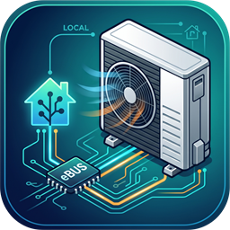

<p align="center">
  
</p>

# aroTHERM & GeniaAir (eBUS) - Integración para Home Assistant

[](https://github.com/hacs/default)
[](https://www.home-assistant.io/)
[](https://www.home-assistant.io/blog/2016/02/12/classifying-the-internet-of-things/)
[](https://github.com/R91g/arotherm-genia-ebusd/blob/main/LICENSE)

[🇬🇧 Read in English](README.md) | **🇪🇸 Español**

---

**aroTHERM & GeniaAir (eBUS)** (`arotherm_genia_ebusd`) es una integración personalizada de Home Assistant para bombas de calor aire-agua R290 de **Vaillant** y **Saunier Duval** gobernadas por reguladores `sensoCOMFORT` (`VRC 720`) o `MiPro Sense` (`SRC 720`). Se comunica con la instalación localmente a través de [ebusd](https://github.com/john30/ebusd) por MQTT, sin necesidad de cuenta ni pasarela cloud.

Las definiciones de registros que `ebusd` incluye por defecto son anteriores a estas placas R290 y no cubren la mayoría de sus mensajes, por lo que este proyecto aporta sus propios CSV para la unidad exterior (`08.hmux0` / `08.hmu`), el regulador climático (`15.bass3` / `15.basv3` / `15.ctlv2` / `15.ctlv3`), el módulo hidráulico (`76.vwzio`) y el receptor inalámbrico (`04.netx3`). Sobre esa telemetría decodificada añade entidades tipadas agrupadas por dispositivo físico y control local: consignas, modos de funcionamiento, programaciones horarias, quick veto, modo vacaciones y diagnóstico del bus.

## Características

- Local push sobre la salida JSON MQTT de `ebusd`; sin entidades de autodescubrimiento de `ebusd` en Home Assistant.
- Escucha pasiva del bus combinada con las lecturas programadas del propio `ebusd` (`r1` para potencia eléctrica, `r2` para impulsión/retorno/caudal); la integración añade un sondeo `/get` de respaldo suave solo cuando no hay pasarela cloud oficial.
- Climatización de Zona 1 (calor / frío / apagado) con presets (programado, manual continuo, eco, quick veto, vacaciones), filtrado de valores centinela del firmware, gestión automática del calendario del doble bloqueo de refrigeración y prioridad del modo vacaciones sobre el frío.
- ACS con carga puntual (boost) que eleva temporalmente la consigna para sortear la histéresis de carga de fábrica, además de control semanal de día y hora antilegionella.
- Escritura de programaciones horarias de calefacción, refrigeración, ACS, circulación y modo silencioso, con hasta 3 franjas diarias y resolución de 1 minuto.
- Quick veto nativo en calefacción y quick veto temporal persistente en refrigeración gestionado por la integración entre reinicios.
- Contadores de energía por modo con resolución de Wh, potencia térmica y COP/EER calculados, listos para el Panel de Energía.
- Diagnóstico TCP opcional de `ebusd` (`info` y verificación CSV `find`), detección de CSV ausentes, volcados anonimizados y acciones de lectura/escritura simbólica de registros.
- Interfaz en inglés, español y alemán.

## Hardware Compatible

La integración cubre las familias R290 Vaillant `aroTHERM plus` / Saunier Duval `GeniaAir Max` (generaciones actuales `/7.1` y anteriores `/6`), los módulos hidráulicos y torres `76.vwzio` (`VWZ MEH/MH`, `uniTOWER`, `HPIM 7`, `GeniaSet`), los reguladores `VRC 720` / `SRC 720` (incluidas las variantes `720/2` y `720/3`) y el termostato inalámbrico y la pasarela cloud opcionales.

Las tablas completas de modelos y el estado de validación de cada placa (cuáles están verificadas en el hardware del propio desarrollador y cuáles dependen de mapas de registros e informes de la comunidad) están en **[docs/hardware_es.md](docs/hardware_es.md)**.

## Inicio Rápido

1. **Despliega los archivos CSV de `ebusd`** desde [`ebusd-configuration/`](ebusd-configuration/) en el directorio de configuración de `ebusd` y arranca `ebusd` con `--mqttjson`.
2. **Instala la integración** desde el catálogo por defecto de HACS (o copia `custom_components/arotherm_genia_ebusd` manualmente) y reinicia Home Assistant.
3. **Añade la integración** en **Ajustes → Dispositivos y Servicios**, elige fabricante y modelos de hardware, y espera aproximadamente un minuto a la hidratación inicial.

La guía completa, con cableado, flags de arranque de `ebusd` y verificación inicial, está en **[docs/installation_es.md](docs/installation_es.md)**.

## Documentación

| Documento | Contenido |
| :--- | :--- |
| [Hardware Compatible](docs/hardware_es.md) ([EN](docs/hardware.md)) | Tablas completas de modelos y estado de validación por placa |
| [Instalación](docs/installation_es.md) ([EN](docs/installation.md)) | Requisitos, cableado, despliegue de CSV en ebusd, instalación HACS/manual, verificación inicial |
| [Configuración](docs/configuration_es.md) ([EN](docs/configuration.md)) | Reconfiguración, opciones en caliente, uso diario, Panel de Energía |
| [Acciones (Servicios)](docs/services_es.md) ([EN](docs/services.md)) | Todas las acciones `arotherm_genia_ebusd.*` con parámetros y ejemplos YAML |
| [Solución de Problemas y FAQ](docs/troubleshooting_es.md) ([EN](docs/troubleshooting.md)) | Diagnósticos, preguntas frecuentes, cómo reportar un issue |
| [Referencia Técnica](docs/technical_reference_es.md) ([EN](docs/technical_reference.md)) | Protocolo eBUS obtenido por ingeniería inversa: tramas, registros, temporizadores, bloqueos |
| [Changelog](CHANGELOG.md) | Historial de versiones |

## Desarrollo y Pruebas

El repositorio incluye una suite de tests unitarios offline (sin necesidad de un Home Assistant en ejecución) y workflows de GitHub Actions para Hassfest, validación HACS, Ruff y Pyright:

```bash
python -m unittest discover tests -v
ruff check .
ruff format --check .
```

## Agradecimientos

- **[john30/ebusd](https://github.com/john30/ebusd) y [ebusd-configuration](https://github.com/john30/ebusd-configuration):** el demonio eBUS, las especificaciones del protocolo y la base de datos comunitaria de registros que hacen posible la comunicación local.
- **[signalkraft/ebusd-vaillant-component](https://github.com/signalkraft/ebusd-vaillant-component):** inspiración para los servicios de volcado de diagnóstico y grabación de topics en vivo.
- **[MarkBovee/vaillant-ebus](https://github.com/MarkBovee/vaillant-ebus):** exploración de registros de reguladores Vaillant y capturas reales de la comunidad.

## Licencia y Aviso Legal

Distribuido bajo la **[Licencia MIT](LICENSE)** - Copyright (c) 2026 [@R91g](https://github.com/R91g).

Este es un proyecto comunitario de código abierto independiente, no afiliado, respaldado ni soportado por **Vaillant GmbH** o **Saunier Duval**. Úsalo bajo tu propia responsabilidad; modifica los parámetros hidráulicos o de bivalencia de nivel instalador solo si comprendes el diseño de tu sistema de calefacción.
