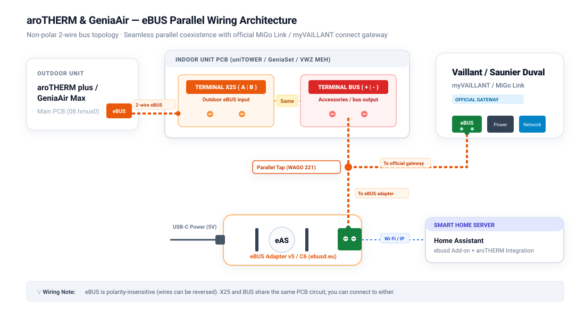
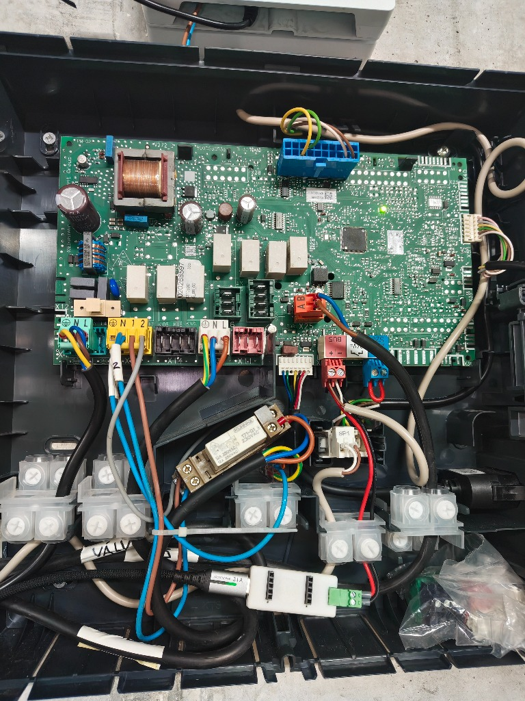

# Installation Guide

**🇬🇧 English** | [🇪🇸 Versión en Español](installation_es.md)

This guide covers the full setup: physical adapter, `ebusd` configuration, integration install and first-run verification. Allow 30-45 minutes.

---

## 1. Prerequisites

1. **Physical eBUS adapter** connected in parallel to the 2-wire eBUS terminals (`+`/`-`, polarity-insensitive) of your heat pump, hydraulic module or wall controller - for example, the [eBUS Adapter Shield v5 / C6](https://adapter.ebusd.eu/) (Ethernet, Wi-Fi or USB).
2. **`ebusd` daemon (v23.2 or newer)** running either as the Home Assistant eBUSd Add-on or as a standalone Linux service / Docker container, connected to your MQTT broker with `--mqttjson` enabled.
3. **Home Assistant (`2024.12.0` or newer, the minimum version declared to HACS)** with the core [MQTT integration](https://www.home-assistant.io/integrations/mqtt/) installed and connected to the same MQTT broker as `ebusd`.

### Physical Wiring & Coexistence

eBUS is a 2-wire, 24 V differential serial bus that connects all heating devices in parallel. You can connect the adapter at any point where the bus is accessible (indoor hydraulic station, outdoor unit or wall controller).

<p align="center">
  
</p>

> **Safety:** disconnect the mains power supply before opening the electrical enclosure of any unit, and follow your equipment's installation manual. If you are not confident working inside the unit, have a qualified installer connect the adapter. The terminal layout described below is documented from a Saunier Duval GeniaSet / Vaillant uniTOWER indoor board (see the photo); other models may differ, so check the manual of your own unit.

**Wiring notes for the documented board:**

- **Terminal `BUS (+ / -)` (red header):** intended for system accessories; the official cloud gateway (`myVAILLANT connect` / `MiGo Link`) usually connects here. You can connect the eBUS adapter in parallel on this same port (double-crimping into the screw terminal or with WAGO 221 lever connectors).
- **Terminal `X25 (A / B)` (orange header):** the communication line from the outdoor unit lands here. On the documented board, `BUS` and `X25` are interconnected on the PCB traces; verify this on your own unit before treating the two ports as equivalent.
- **Polarity:** the eBUS specification is polarity-insensitive (devices rectify the line internally), so reversing `+`/`-` (or `A`/`B`) does not damage the bus.
- **Coexistence with the official gateway:** if you have `myVAILLANT connect` or `MiGo Link`, do not remove it. The integration passively captures the telemetry it requests, which reduces bus utilization.

<details>
<summary>📸 <b>Real-World Installation Photograph (Indoor Hydraulic Board)</b></summary>
<br>

<p align="center">
  
  <br>
  <em>Real installation inside a Saunier Duval GeniaSet / Vaillant uniTOWER electrical enclosure. The eBUS Adapter C6 is powered via USB-C at the bottom, connected in parallel with the official MiGo Link gateway on the red <code>BUS</code> terminal, while the outdoor unit bus enters through the orange <code>X25 (A/B)</code> connector.</em>
</p>

</details>

---

## 2. Deploy the ebusd CSV Configuration

> **Why are the bundled CSV files required?**
> The default CSV definitions distributed with `ebusd` predate these R290 heat pump boards and do not include most of their messages. The CSV files in [`ebusd-configuration/`](../ebusd-configuration/) define the registers of the `08.hmux0`, `08.hmu`, `15.bass3`/`basv3`/`ctlv2`/`ctlv3`, `76.vwzio` and `04.netx3` boards, and rely primarily on passive frame capture to keep bus traffic low: the eBUS medium runs at 2400 baud and is shared with the wall controller, so every actively polled register competes with normal system traffic.

Copy the CSV files into your `ebusd` configuration directory preserving this exact structure:

```text
<ebusd-config-root>/en/
├── broadcast.csv              <-- MUST be placed in the root of en/ (NEVER inside vaillant/)
└── vaillant/
    ├── 04.netx3.csv           <-- Wireless room thermostat receiver (NETX3 / NETX2)
    ├── 08.hmu.csv             <-- Outdoor heat pump board (international / HMU00 variants)
    ├── 08.hmu.HW5103.csv      <-- Outdoor heat pump board (HW=5103 matching priority)
    ├── 08.hmux0.csv           <-- Outdoor heat pump board (aroTHERM plus / GeniaAir Max)
    ├── 15.bass3.csv           <-- Climate controller (MiPro Sense SRC 720 / sensoCOMFORT VRC 720)
    ├── 15.basv3.csv           <-- Climate controller (sensoCOMFORT VRC 720 reporting BASV3)
    ├── 15.ctlv2.csv           <-- Climate controller (sensoCOMFORT VRC 720/2)
    ├── 15.ctlv3.csv           <-- Climate controller (sensoCOMFORT VRC 720/3)
    ├── 76.vwzio.csv           <-- Hydraulic module / tower (VWZ MEH / uniTOWER / HPIM 7 / GeniaSet)
    └── f6.netx3.csv           <-- Wireless room thermostat passive RF frames
```

### Option A: Home Assistant eBUSd Add-on ([LukasGrebe/ha-addons](https://github.com/LukasGrebe/ha-addons))

1. Copy `ebusd-configuration/broadcast.csv` to:
   `/addon_configs/b4d7ad18_ebusd/ebusd-configuration/en/broadcast.csv`
2. Copy all files inside `ebusd-configuration/vaillant/*.csv` to:
   `/addon_configs/b4d7ad18_ebusd/ebusd-configuration/en/vaillant/`
3. Configure the add-on (**Settings → Add-ons → eBUSd → Configuration**):
   - **Disable the "Seed HA MQTT integration config (only needed once)" toggle** (`seed_mqtt_cfg: false`).
     > When enabled, the add-on injects its bundled `mqtt-hassio.cfg` with `filter-seen = 5`, which polls a broad set of legacy registers every 16 minutes and creates a large number of unmanaged MQTT entities in Home Assistant. With the toggle off, polling is controlled exclusively by the CSV definitions from this repository.
     >
     > If the add-on previously ran with this seed enabled, delete the orphaned `ebusd` devices under **Settings → Devices & Services → MQTT**.
   - **Add these startup arguments in `commandline_options` (one per entry):**
     ```text
     --mqttjson
     --configpath=/config/ebusd-configuration/en
     --scanconfig
     --accesslevel=*
     --mqtttopic=ebusd/%circuit/%name
     --mqttvar=filter-direction=r|u|^w
     ```
     > **Remember `--mqttjson` explicitly.** The add-on only appends it automatically while the seed toggle is enabled; once you disable the seed, you must add it yourself or `ebusd` will publish plain values the integration cannot parse.
     >
     > What each flag does:
     > - `--mqttjson`: publishes messages as JSON (`{"value": ...}`), required by the coordinator.
     > - `--configpath`: loads the CSVs from this repository instead of the online defaults.
     > - `--scanconfig`: probes the bus on startup and binds circuits (`08`, `15`, `76`, `04`) to their CSV files.
     > - `--accesslevel=*`: allows reading and writing installer-level parameters (heating curves, bivalence points, limits).
     > - `--mqtttopic=ebusd/%circuit/%name`: structures topics per circuit and message.
     > - `--mqttvar=filter-direction=r|u|^w`: permits write operations (`^w`) for setpoints, modes and curves.
     >
     > `--pollinterval` is intentionally omitted so `ebusd` keeps its default 5-second cycle, which matches the CSV read priorities (`r1`/`r2`/`r9`). `--enablehex` is only needed if you plan to use the optional `send_hex_command` diagnostic action.
4. Restart the `eBUSd` add-on and check its log: circuits `08.hmux0` (or `08.hmu`), `15.bass3` (or `15.basv3` / `15.ctlv2` / `15.ctlv3`) and `76.vwzio` should load after the bus scan.

### Option B: Standalone Linux / Docker ebusd

1. Copy `ebusd-configuration/broadcast.csv` to `/etc/ebusd/en/broadcast.csv` (or your mapped Docker volume).
2. Copy `ebusd-configuration/vaillant/*.csv` to `/etc/ebusd/en/vaillant/`.
3. Add to `/etc/default/ebusd` (`EBUSD_OPTS`) or your `docker-compose.yml` command (keep the quotes: without them the shell interprets `|` and `*`):
   ```text
   --configpath=/etc/ebusd/en --scanconfig '--accesslevel=*' --mqttjson '--mqtttopic=ebusd/%circuit/%name' '--mqttvar=filter-direction=r|u|^w' --mqtthost=<BROKER_IP> --mqttport=1883 --mqttuser=<USER> --mqttpass=<PASS>
   ```
4. Restart `ebusd` (`sudo systemctl restart ebusd` or `docker compose restart ebusd`).

---

## 3. Install the Integration

### Method A: HACS (Recommended)

[](https://my.home-assistant.io/redirect/hacs_repository/?owner=R91g&repository=arotherm-genia-ebusd&category=integration)

Or manually:

1. Open **HACS** in the Home Assistant sidebar.
2. Search for **`aroTHERM & GeniaAir (eBUS)`** (or `arotherm_genia_ebusd`).
3. Open the integration card and click **Download**.
4. **Restart Home Assistant** so Python loads the new custom component.

> The integration is included in the HACS default catalog, so you do not need to add a custom repository URL.

### Method B: Manual

1. Download the latest release (or clone this repository).
2. Copy the `custom_components/arotherm_genia_ebusd` folder into `/config/custom_components/`.
3. **Restart Home Assistant**.

---

## 4. Configure in Home Assistant

Setup is done entirely through the UI; no `configuration.yaml` edits are required.

[](https://my.home-assistant.io/redirect/config_flow_start/?domain=arotherm_genia_ebusd)

1. Go to **Settings → Devices & Services** (or use the button above).
2. Click **+ Add Integration** and search for **aroTHERM & GeniaAir (eBUS)**.
3. **Step 1 - MQTT & Manufacturer:**
   - **eBUSd MQTT topic prefix:** default `ebusd` (matching `--mqtttopic=ebusd/%circuit/%name`).
   - **Equipment manufacturer:** `Vaillant` or `Saunier Duval`.
4. **Step 2 - Hardware Models:**
   - **Outdoor unit (heat pump):** filtered by brand (e.g. `aroTHERM plus ES VWL 85/7.1 A 230V` or `GeniaAir Max ES 15`).
   - **Indoor hydraulic module:** filtered by brand (e.g. `VWZ MEH 97/7`, `uniTOWER VIH QW 190/7`, `HPIM 7 230V`, `GeniaSet FEW/FIW 200-7`).
   - **Wireless room thermostat (`04.netx3`):** enable if you have a wireless `sensoCOMFORT RF` / `MiPro Sense RF` room unit; disable for wired-only setups.
   - **Official cloud gateway (`f1`):** enable if a `myVAILLANT connect` / `MiGo Link` is on the bus (passive listening); disable otherwise (activates paced fallback `/get` polling).
5. Click **Submit**. The staggered hydration queue populates all registers within about 60 seconds.

---

## 5. First-Run Verification

- Entities may show `Unknown` for the first 30-60 seconds: the coordinator waits `5.0 s` for retained MQTT payloads and then requests missing registers one at a time (`0.8 s` apart) to protect the bus. This is normal.
- Check that the four logical devices appear: **Outdoor Unit**, **Climate Controller**, **Hydraulic Interface** and, if enabled, **Wireless Room Thermostat**.
- Verify MQTT JSON output with:
  ```bash
  mosquitto_sub -h <MQTT_BROKER_IP> -u <USER> -P <PASS> -t "ebusd/#" -v
  ```
  Payloads should look like `ebusd/hmux0/RunDataFlowTemp {"value": {"value": 34.25}}`. If you see plain numbers, add `--mqttjson` to your `ebusd` flags and restart `ebusd`.

Next steps: [runtime options and Energy Dashboard](configuration.md) · [actions reference](services.md) · [troubleshooting](troubleshooting.md)

