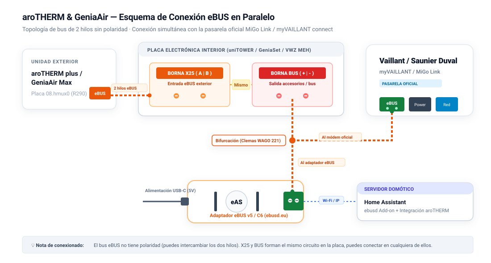
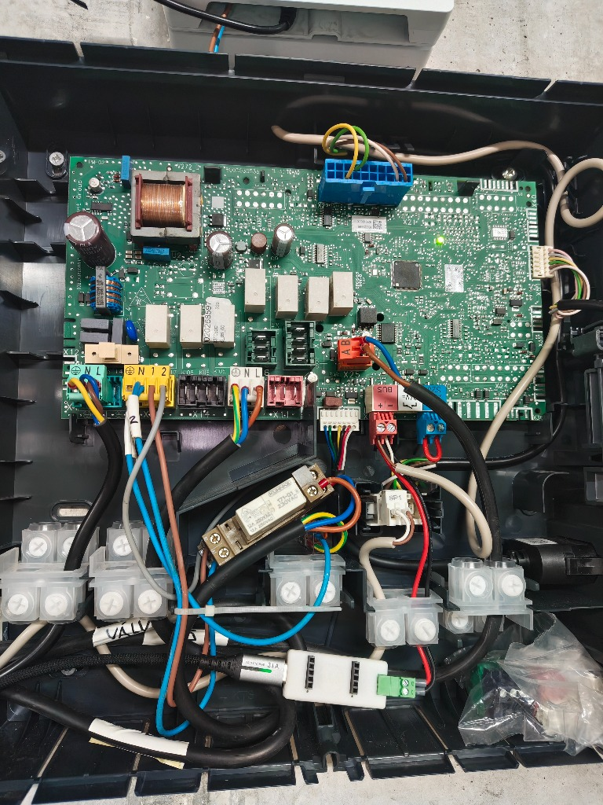

# Guía de Instalación

[🇬🇧 Read in English](installation.md) | **🇪🇸 Español**

Esta guía cubre la instalación completa: adaptador físico, configuración de `ebusd`, instalación de la integración y verificación inicial. Reserva entre 30 y 45 minutos.

---

## 1. Requisitos Previos

1. **Adaptador eBUS físico** conectado en paralelo a los terminales eBUS de 2 hilos (`+`/`-`, insensible a la polaridad) de tu bomba de calor, módulo hidráulico o regulador de pared - por ejemplo, el [eBUS Adapter Shield v5 / C6](https://adapter.ebusd.eu/) (Ethernet, Wi-Fi o USB).
2. **Demonio `ebusd` (v23.2 o superior)** ejecutándose como el Add-on eBUSd de Home Assistant o como servicio Linux / contenedor Docker independiente, conectado a tu broker MQTT con `--mqttjson` activado.
3. **Home Assistant (`2024.12.0` o superior, la versión mínima declarada a HACS)** con la [integración MQTT](https://www.home-assistant.io/integrations/mqtt/) instalada y conectada al mismo broker MQTT que `ebusd`.

### Cableado Físico y Coexistencia

eBUS es un bus serie diferencial de 2 hilos y 24 V que conecta todos los equipos de calefacción en paralelo. Puedes conectar el adaptador en cualquier punto accesible del bus (estación hidráulica interior, unidad exterior o regulador de pared).

<p align="center">
  
</p>

> **Seguridad:** desconecta la alimentación eléctrica antes de abrir el armario eléctrico de cualquier unidad y sigue el manual de instalación de tu equipo. Si no tienes confianza para trabajar dentro de la unidad, deja que un instalador cualificado conecte el adaptador. El esquema de terminales descrito abajo está documentado sobre una placa interior Saunier Duval GeniaSet / Vaillant uniTOWER (ver foto); otros modelos pueden variar, así que comprueba el manual de tu unidad.

**Notas de cableado para la placa documentada:**

- **Terminal `BUS (+ / -)` (regleta roja):** destinado a accesorios del sistema; la pasarela cloud oficial (`myVAILLANT connect` / `MiGo Link`) suele conectarse aquí. Puedes conectar el adaptador eBUS en paralelo en este mismo puerto (crimpando dos hilos en el mismo terminal o con conectores de palanca WAGO 221).
- **Terminal `X25 (A / B)` (regleta naranja):** aquí llega la línea de comunicación de la unidad exterior. En la placa documentada, `BUS` y `X25` están interconectados en las pistas de la PCB; verifícalo en tu propia unidad antes de tratar los dos puertos como equivalentes.
- **Polaridad:** la especificación eBUS es insensible a la polaridad (los equipos rectifican la línea internamente), así que invertir `+`/`-` (o `A`/`B`) no daña el bus.
- **Coexistencia con la pasarela oficial:** si tienes `myVAILLANT connect` o `MiGo Link`, no la retires. La integración captura pasivamente la telemetría que solicita, lo que reduce la utilización del bus.

<details>
<summary>📸 <b>Fotografía de una Instalación Real (Placa Hidráulica Interior)</b></summary>
<br>

<p align="center">
  
  <br>
  <em>Instalación real dentro del armario eléctrico de un Saunier Duval GeniaSet / Vaillant uniTOWER. El eBUS Adapter C6 se alimenta por USB-C en la parte inferior, conectado en paralelo con la pasarela oficial MiGo Link en el terminal rojo <code>BUS</code>, mientras el bus de la unidad exterior entra por el conector naranja <code>X25 (A/B)</code>.</em>
</p>

</details>

---

## 2. Desplegar los Archivos CSV de ebusd

> **¿Por qué son obligatorios los CSV incluidos?**
> Las definiciones CSV que `ebusd` distribuye por defecto son anteriores a estas placas de bombas R290 y no incluyen la mayoría de sus mensajes. Los CSV de [`ebusd-configuration/`](../ebusd-configuration/) definen los registros de las placas `08.hmux0`, `08.hmu`, `15.bass3`/`basv3`/`ctlv2`/`ctlv3`, `76.vwzio` y `04.netx3`, y se apoyan principalmente en la captura pasiva de tramas para mantener bajo el tráfico del bus: el medio eBUS funciona a 2400 baudios y se comparte con el regulador de pared, así que cada registro sondeado activamente compite con el tráfico normal del sistema.

Copia los archivos CSV en el directorio de configuración de `ebusd` respetando exactamente esta estructura:

```text
<raiz-config-ebusd>/en/
├── broadcast.csv              <-- DEBE ir en la raíz de en/ (NUNCA dentro de vaillant/)
└── vaillant/
    ├── 04.netx3.csv           <-- Receptor del termostato inalámbrico (NETX3 / NETX2)
    ├── 08.hmu.csv             <-- Placa unidad exterior (variantes internacionales / HMU00)
    ├── 08.hmu.HW5103.csv      <-- Placa unidad exterior (prioridad para HW=5103)
    ├── 08.hmux0.csv           <-- Placa unidad exterior (aroTHERM plus / GeniaAir Max)
    ├── 15.bass3.csv           <-- Regulador climático (MiPro Sense SRC 720 / sensoCOMFORT VRC 720)
    ├── 15.basv3.csv           <-- Regulador climático (sensoCOMFORT VRC 720 reportando BASV3)
    ├── 15.ctlv2.csv           <-- Regulador climático (sensoCOMFORT VRC 720/2)
    ├── 15.ctlv3.csv           <-- Regulador climático (sensoCOMFORT VRC 720/3)
    ├── 76.vwzio.csv           <-- Módulo hidráulico / torre (VWZ MEH / uniTOWER / HPIM 7 / GeniaSet)
    └── f6.netx3.csv           <-- Tramas RF pasivas del termostato inalámbrico
```

### Opción A: Add-on eBUSd de Home Assistant

1. Copia `ebusd-configuration/broadcast.csv` a:
   `/addon_configs/b4d7ad18_ebusd/ebusd-configuration/en/broadcast.csv`
2. Copia todos los archivos de `ebusd-configuration/vaillant/*.csv` a:
   `/addon_configs/b4d7ad18_ebusd/ebusd-configuration/en/vaillant/`
3. Configura el add-on (**Ajustes → Add-ons → eBUSd → Configuración**):
   - **Desactiva el interruptor "Seed HA MQTT integration config (only needed once)"** (`seed_mqtt_cfg: false`).
     > Cuando está activo, el add-on inyecta su archivo `mqtt-hassio.cfg` con `filter-seen = 5`, que sondea un amplio conjunto de registros antiguos cada 16 minutos y crea un gran número de entidades MQTT sin gestionar en Home Assistant. Con el interruptor desactivado, el sondeo queda controlado exclusivamente por las definiciones CSV de este repositorio.
     >
     > Si el add-on ya funcionó antes con esta opción activada, borra los dispositivos `ebusd` huérfanos en **Ajustes → Dispositivos y Servicios → MQTT**.
   - **Añade estos argumentos de arranque en `commandline_options` (uno por entrada):**
     ```text
     --mqttjson
     --configpath=/config/ebusd-configuration/en
     --scanconfig
     --accesslevel=*
     --mqtttopic=ebusd/%circuit/%name
     --mqttvar=filter-direction=r|u|^w
     ```
     > **No olvides `--mqttjson` explícitamente.** El add-on solo lo añade automáticamente mientras el interruptor de seed está activado; al desactivarlo, debes añadirlo tú o `ebusd` publicará valores planos que la integración no puede interpretar.
     >
     > Qué hace cada flag:
     > - `--mqttjson`: publica los mensajes en JSON (`{"value": ...}`), requerido por el coordinador.
     > - `--configpath`: carga los CSV de este repositorio en lugar de los por defecto en línea.
     > - `--scanconfig`: sondea el bus al arrancar y vincula los circuitos (`08`, `15`, `76`, `04`) con sus CSV.
     > - `--accesslevel=*`: permite leer y escribir parámetros de nivel instalador (curvas de calefacción, puntos de bivalencia, límites).
     > - `--mqtttopic=ebusd/%circuit/%name`: estructura los topics por circuito y mensaje.
     > - `--mqttvar=filter-direction=r|u|^w`: habilita las escrituras (`^w`) para consignas, modos y curvas.
     >
     > `--pollinterval` se omite a propósito para que `ebusd` mantenga su ciclo por defecto de 5 segundos, que coincide con las prioridades de lectura de los CSV (`r1`/`r2`/`r9`). `--enablehex` solo es necesario si piensas usar la acción de diagnóstico opcional `send_hex_command`.
4. Reinicia el add-on `eBUSd` y comprueba en su registro que los circuitos `08.hmux0` (o `08.hmu`), `15.bass3` (o `15.basv3` / `15.ctlv2` / `15.ctlv3`) y `76.vwzio` se cargan tras el escaneo del bus.

### Opción B: ebusd independiente en Linux / Docker

1. Copia `ebusd-configuration/broadcast.csv` a `/etc/ebusd/en/broadcast.csv` (o tu volumen Docker mapeado).
2. Copia `ebusd-configuration/vaillant/*.csv` a `/etc/ebusd/en/vaillant/`.
3. Añade a `/etc/default/ebusd` (`EBUSD_OPTS`) o al comando de tu `docker-compose.yml` (mantén las comillas: sin ellas el intérprete de comandos interpreta `|` y `*`):
   ```text
   --configpath=/etc/ebusd/en --scanconfig '--accesslevel=*' --mqttjson '--mqtttopic=ebusd/%circuit/%name' '--mqttvar=filter-direction=r|u|^w' --mqtthost=<IP_BROKER> --mqttport=1883 --mqttuser=<USUARIO> --mqttpass=<CLAVE>
   ```
4. Reinicia `ebusd` (`sudo systemctl restart ebusd` o `docker compose restart ebusd`).

---

## 3. Instalar la Integración

### Método A: HACS (Recomendado)

[](https://my.home-assistant.io/redirect/hacs_repository/?owner=R91g&repository=arotherm-genia-ebusd&category=integration)

O manualmente:

1. Abre **HACS** en la barra lateral de Home Assistant.
2. Busca **`aroTHERM & GeniaAir (eBUS)`** (o `arotherm_genia_ebusd`).
3. Abre la tarjeta de la integración y pulsa **Descargar**.
4. **Reinicia Home Assistant** para que Python cargue el nuevo componente.

> La integración está incluida en el catálogo por defecto de HACS, así que no necesitas añadir un repositorio personalizado.

### Método B: Manual

1. Descarga la última release (o clona este repositorio).
2. Copia la carpeta `custom_components/arotherm_genia_ebusd` en `/config/custom_components/`.
3. **Reinicia Home Assistant**.

---

## 4. Configurar en Home Assistant

La configuración se realiza íntegramente desde la interfaz; no hace falta editar `configuration.yaml`.

[](https://my.home-assistant.io/redirect/config_flow_start/?domain=arotherm_genia_ebusd)

1. Ve a **Ajustes → Dispositivos y Servicios** (o usa el botón de arriba).
2. Pulsa **+ Añadir Integración** y busca **aroTHERM & GeniaAir (eBUS)**.
3. **Paso 1 - MQTT y Fabricante:**
   - **Prefijo de topic MQTT de ebusd:** por defecto `ebusd` (coincide con `--mqtttopic=ebusd/%circuit/%name`).
   - **Fabricante del equipo:** `Vaillant` o `Saunier Duval`.
4. **Paso 2 - Modelos de Hardware:**
   - **Unidad exterior (bomba de calor):** filtrada por marca (p. ej. `aroTHERM plus ES VWL 85/7.1 A 230V` o `GeniaAir Max ES 15`).
   - **Módulo hidráulico interior:** filtrado por marca (p. ej. `VWZ MEH 97/7`, `uniTOWER VIH QW 190/7`, `HPIM 7 230V`, `GeniaSet FEW/FIW 200-7`).
   - **Termostato inalámbrico (`04.netx3`):** actívalo si tienes una unidad de ambiente `sensoCOMFORT RF` / `MiPro Sense RF`; desactívalo en instalaciones solo cableadas.
   - **Pasarela cloud oficial (`f1`):** actívala si hay una `myVAILLANT connect` / `MiGo Link` en el bus (escucha pasiva); desactívala en caso contrario (activa el sondeo `/get` de respaldo pausado).
5. Pulsa **Enviar**. La cola de hidratación escalonada rellena todos los registros en unos 60 segundos.

---

## 5. Verificación Inicial

- Algunas entidades pueden mostrar `Desconocido` durante los primeros 30-60 segundos: el coordinador espera `5,0 s` a los mensajes MQTT retenidos y luego solicita los registros que faltan de uno en uno (cada `0,8 s`) para proteger el bus. Es normal.
- Comprueba que aparecen los cuatro dispositivos lógicos: **Unidad Exterior**, **Regulador Climático**, **Interfaz Hidráulica** y, si lo activaste, **Termostato Inalámbrico**.
- Verifica la salida JSON de MQTT con:
  ```bash
  mosquitto_sub -h <IP_BROKER_MQTT> -u <USUARIO> -P <CLAVE> -t "ebusd/#" -v
  ```
  Los payloads deben tener el formato `ebusd/hmux0/RunDataFlowTemp {"value": {"value": 34.25}}`. Si ves números planos, añade `--mqttjson` a los flags de `ebusd` y reinícialo.

Siguientes pasos: [opciones en caliente y Panel de Energía](configuration_es.md) · [referencia de acciones](services_es.md) · [solución de problemas](troubleshooting_es.md)

