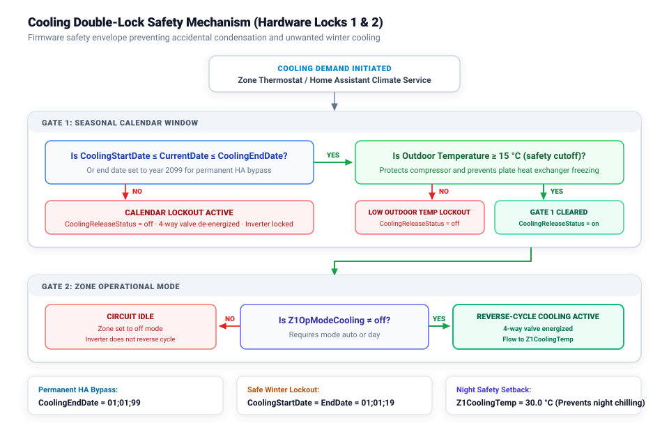
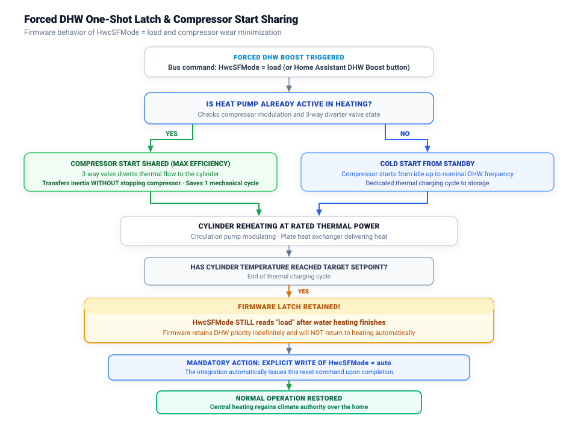

# Technical Reference & Reverse Engineering Documentation
## Saunier Duval Genia Air Max ES / Vaillant aroTHERM plus (eBUS Protocol)

**🇬🇧 English** | [🇪🇸 Versión en Español](technical_reference_es.md)

This document provides a technical breakdown of the reverse-engineered **eBUS** communication protocol for **R290 air-to-water heat pumps** manufactured by the **Vaillant Group** (marketed interchangeably as **Saunier Duval GeniaAir Max**, **Vaillant aroTHERM plus**, and platform siblings equipped with **MiPro Sense / sensoCOMFORT / sensoHOME** controllers and **MiGo Link / sensoNET / myVAILLANT connect** gateways).

---

## 1. Physical Layer, Network Topology & Address Matrix

The eBUS physical layer consists of an unshielded, reverse-polarity tolerant, two-wire serial bus running at **2,400 baud** (half-duplex, 8 data bits, 1 stop bit, no parity). It uses carrier-sense multiple access with collision detection (**CSMA/CD**) and bit-level priority arbitration.

### 1.1 Master-Slave Duality
In the eBUS specification, every physical intelligent micro-controller occupies two logical addresses:
- **Master Address:** Used to initiate arbitration, acquire the line, and transmit command telegrams or queries.
- **Slave Address:** Used to passively listen, acknowledge frames, and answer queries addressed to it.

The mandatory mathematical relationship between master and slave addresses is:
$$\text{Addr}_{\text{Slave}} = \text{Addr}_{\text{Master}} + 0\text{x}05$$

### 1.2 Hardware Identification & Device Map

A standard single-zone or multi-zone installation consists of the following bus participants:

| Master Addr | Slave Addr | Physical Hardware | Manufacturer Device ID | Active Configuration | Functional Role in System |
| :---: | :---: | :--- | :--- | :--- | :--- |
| **`03`** | **`08`** | Outdoor Heat Pump Unit | `MF=Vaillant;ID=HMUX0`<br>`MF=Vaillant;ID=HMU00` | `08.hmux0.csv`<br>`08.hmu.csv`<br>`08.hmu.HW5103.csv` | Variable-speed inverter compressor, ECM evaporator fan, electronic expansion valve (EEV), 4-way reversing valve, hydraulic circuit pressure sensor, refrigerant thermodynamic probes, water-side heat meter, and heating energy integral accumulator. |
| **`10`** | **`15`** | Wall-Mounted Climate Controller | `MF=Vaillant;ID=BASS3`<br>`MF=Vaillant;ID=BASV3`<br>`MF=Vaillant;ID=CTLV2`<br>`MF=Vaillant;ID=CTLV3`<br>*(MiPro Sense / sensoCOMFORT)* | `15.bass3.csv`<br>`15.basv3.csv`<br>`15.ctlv2.csv`<br>`15.ctlv3.csv` | Master system regulator, heating curve math, room ambient temperature & humidity sensor, weekly schedule matrix (`b5 55` with 3 daily slots), DHW & legionella schedules, cooling authorization double-locks, and holiday mode. |
| **`71`** | **`76`** | Indoor Hydraulic Station / Tower | `MF=Vaillant;ID=VWZIO`<br>*(HPIM 7 / MEH 97/7 / uniTOWER / GeniaSet)* | `76.vwzio.csv` | 3-way DHW diverter valve, secondary circulation pump, auxiliary electric backup heater stages, hydraulic station telemetry (`StationState`), and multifunction relay (DHW recirculation). |
| **`f1`** | **`f6`** | Wi-Fi / Ethernet Network Gateway | `MF=Vaillant;ID=NETX3`<br>`MF=Vaillant;ID=NETX2`<br>*(MiGo Link / sensoNET)* | `f6.netx3.csv` | Cloud gateway, NTP network time distribution, vendor mobile application backend polling engine. |
| **`ff`** | **`04`** | Gateway Application Interface / RF Receiver | `MF=Vaillant;ID=NETX3` | `04.netx3.csv` | Wireless room dial telemetry & diagnostic/broadcast interface used with optional RF thermostats and vendor gateways. |
| **`31`** | **`36`** | Dedicated eBUSd Hardware Adapter | `ebusd` | *Internal daemon* | Local bridge interface, arbitration manager, MQTT telemetry publisher, and optional TCP diagnostics daemon (default port `8888`). |

---

## 2. Bus Traffic Analysis, Device Communication Cycles & Periodicity

Understanding which device talks to which, what telegrams are exchanged, and their exact periodicity is critical to avoiding bus saturation on a narrow 2,400-baud line (maximum throughput: ~12 to 15 complete frames per second).

```mermaid
sequenceDiagram
    autonumber
    participant F1 as MiGo Link (f1)
    participant BASS as MiPro Sense (10)
    participant VWZ as Hydraulic Module (76)
    participant HMU as Outdoor Unit (08)
    participant EBUS as Home Assistant / ebusd (31)

    Note over F1,HMU: Continuous Loop (Every 60 Seconds)
    F1->>HMU: b5 16 14 (PowerStatus query)
    HMU-->>F1: Status byte + Power (Watts EXP)
    F1->>VWZ: b5 16 14 (PowerStatus query)
    VWZ-->>F1: Status byte + Standby Power (5.0 W)

    Note over BASS,VWZ: Modulation Loop (Every 10 to 30 Seconds)
    BASS->>VWZ: uw_10 00 (SetMode: HcMode, FlowTempDesired, HwcTempDesired)
    BASS->>HMU: b5 11 01 (Status01: Circuit Temps & Pump States)

    Note over F1,HMU: Hourly Sweep (Minutes :58 to :00)
    F1->>HMU: b5 16 1000ffff (Cumulative Energy Counters Wh)
    HMU-->>F1: Electrical & Thermal Wh per mode
    F1->>BASS: b5 55 a4 / a5 (Weekly Schedule Sync)

    Note over BASS,HMU: Midnight Rollover (00:00:01 CET)
    BASS->>HMU: b5 16 11 (EEPROM Table Descriptors)
    BASS->>HMU: b5 16 10 (Daily Historical Bucket Archive)

    Note over EBUS,HMU: Controlled Local Polling (Low Bus Overhead)
    EBUS->>HMU: Poll level 1 (r1;u): RunDataElectricPowerConsumption
    EBUS->>HMU: Poll level 2 (r2;u): RunDataFlowTemp, RunDataReturnTemp, RunDataFlowRate
    EBUS->>BASS: Poll level 9 (r9;u): Mode, setpoints, energy accumulators, pressures
    EBUS--)HMU: Passive Capture (u / r;u): 140+ schedule slots, StateCompressor & PowerStatus
```

### 2.1 The Gateway Engine (`f1` / `NETX3`)
When present on the bus, the vendor network gateway acts as a polling master:
1. **The 60-Second Power Loop:** Every 60 seconds ($\pm 1\text{ s}$), `f1` queries `b5 16 14` (`PowerStatus`) from both `08` (outdoor unit) and `76` (hydraulic module). This telegram yields instantaneous power consumption in Watts and the active mode byte.
2. **The Hourly Energy Sweep:** Around minute 58 to 00 of every hour, `f1` sweeps the cumulative IEEE 754 energy counters under `b5 16 1000ffff`, retrieving electrical and thermal Wh to upload hourly consumption bins to the vendor cloud.
3. **The Schedule Polling Sweep:** Periodically (and immediately whenever a user opens the official smartphone app), `f1` queries `b5 55 a4` (slot count) followed by `b5 55 a5` across weekly timer circuits (`00`..`04`) to synchronize programs.
4. **Broadcast Time Synchronization:** Broadcasts real-time clock timestamps over the bus to keep slave microcontrollers synchronized.

### 2.2 The Master Climate Regulator (`10` / `BASS3` / `BASV3` / `CTLV2` / `CTLV3`)
The central controller manages thermodynamics, safety envelopes, and daily archiving:
1. **The Continuous Modulation Loop (10–30 s):** Sends command `uw_10 00` (`SetMode`) to the hydraulic module (`76`) and outdoor unit (`08`). This telegram contains the active system mode (`0=auto`, `1=off`, `2=heat`, `3=water`), the flow temperature target (`flowtempdesired`, encoded as `D1C`), the DHW target (`hwctempdesired`), and secondary circuit pump flags.
2. **Hydraulic Telemetry Reading (10–15 s) & Compressor State (60 s):** Polls `b5 11 01` (`Status01`) from `76` and `08` every 10–15 s, collecting flow, return, storage, outdoor temperatures, and pump status bytes (`0=off`, `1=on`, `2=overrun`, `4=hwc`), and polls `b5 11 00` (`StateCompressor`) from `08` every 60 s for compressor operating state and modulation percentage.
3. **The Midnight EEPROM Rollover (`00:00:01` Daily):** At one second past midnight, `10` emits command `b5 16 11` to inspect the EEPROM slot table, rotates the daily historical energy registers in `08` and `76`, writes the end-of-day total, and advances the 16-bit date stamp.

### 2.3 The Outdoor Heat Pump (`03` / `HMUX0` / `HMU00`)
The outdoor inverter unit continuously processes internal safety and thermodynamic loops:
1. **Operational Telemetry (`b5 09 540200` / `b5 1a`):** Updates internal operational registers: compressor frequency (rps), inverter modulation, electronic expansion valve (EEV) step position, evaporator temperature, compressor inlet/discharge temperatures, and water-side heat output (`HmuHeatOutput`).
2. **System Broadcasts (`broadcast.csv`):** Emits passive broadcast telegrams (`fe b5 05` / `fe b5 16` / `fe 07 00`) for system date/time, outdoor temperature (`Outsidetemp`), and active cooling cycle (`CoolingStatus`).

### 2.4 eBUSd & Home Assistant Pacing Strategy
Because `10` (and `f1`, if present) already exchange frames continuously, the bundled CSV definitions use a **three-tier read-priority layout** calibrated for eBUSd's default `--pollinterval=5` cycle:
- **Level 1 (`r1;u`):** Reserved exclusively for **Real-Time Electric Power** (`RunDataElectricPowerConsumption` across `08.hmux0.csv`, `08.hmu.csv`, and `08.hmu.HW5103.csv`). Ensures top-priority live wattage updates every ~9–18 seconds regardless of whether a cloud gateway is installed.
- **Level 2 (`r2;u`):** Reserved strictly for **Live Hydraulic ΔT & Thermal Power** (`RunDataFlowTemp`, `RunDataReturnTemp`, `RunDataFlowRate` across all outdoor CSVs), updating ~every 18–36 seconds for responsive live thermal power and COP/EER calculations.
- **Level 9 (`r9;u`):** Low-frequency active polling for slow accumulators, refrigerant temperatures/pressures, compressor silent level (`CompressorSilentOperationLevel`), heating energy integral (`EnergyIntegral`), quick-veto config registers (`Z1QuickVetoTemp`, `Z1QuickVetoDuration`), and controller/HMU energy totals.
- **Passive Listening (`u` and `r;u`):** Over 140 weekly schedule register entries (`*_Timer*`), `StateCompressor` (`b5 11 00`), `StationState` (`b5 12 0f0613`), `b5 16` EEPROM energy counters, and `PowerStatus` (`b5 16 14`) generate zero scheduled polling overhead when idle, absorbing traffic already emitted by `10` and `f1`. When no cloud gateway is installed (`f1` option disabled), Home Assistant adds an explicit, staggered `/get` fallback loop for core registers (`fallback_poll_interval`, default `300 s`).

---

## 3. High-Precision IEEE 754 Energy Telemetry (`b5 16`)

### 3.1 Frame Structure & Decoding Matrix
Energy telemetry commands follow an 8-byte request / 11-byte response structure:
- **Request (`QQ -> 08 / 76 / 15`):** `10 <period> ff ff <source> <usage> <packed_date_2B>`
- **Response (`11 Bytes`):** `<status_flags_3B> <source> <usage> <packed_date_2B> <energy_EXP_4B_Wh>`

#### Field Definitions:
- **`<period>`:**
  - `0x00`: **Cumulative Lifetime Total** (`total_increasing`).
  - `0x01`: Daily history slot.
  - `0x02`: Monthly history slot.
  - `0x03`: Yearly history slot.
- **`<source>`:** High nibble indicates energy direction (`0x80` = consumed/input, `0x40` = delivered/output):
  - `0x01`: Solar thermal energy (`StatSolarEnergySum`).
  - `0x02` / `0x42`: **Environmental yield extracted from outdoor air** (Wh).
  - `0x03` / `0x83`: **Electrical energy consumed** (Wh).
  - `0x04` / `0x84`: Fuel / gas energy (returns `0.0 Wh` on heat pumps).
  - `0x49`: **Thermal energy delivered** to water (Wh).
- **`<usage>` (Operational Circuit):**
  - `0x00`: Combined total across all modes.
  - `0x03`: **Heating Mode (`Hc`)**.
  - `0x04`: **Domestic Hot Water Mode (`Hwc`)**.
  - `0x05`: **Cooling Mode (`Cool`)**.
- **`<packed_date_2B>`:** 16-bit little-endian integer (`yyyyyyy mmmm ddddd`, year offset from 2000):
  - Example: `0x350d` (`0d35`) $\rightarrow$ `2026-08-13` (physical commissioning date).
  - Example: `0x3521` (`2135`) $\rightarrow$ `2026-09-01` (September monthly bucket).
  - Example: `0x3541` (`4135`) $\rightarrow$ `2026-10-01` (October monthly bucket).
- **`<energy_EXP_4B_Wh>`:** 32-bit single-precision IEEE 754 floating point in little-endian (`EXP`). Measured natively in **Watt-hours (`Wh`)**.

### 3.2 EEPROM Slot Table (`08.hmux0` & `76.vwzio`) & `HMU00` Fallback
The midnight descriptor query (`b5 16 11`) reports the internal non-volatile memory layout on Monobloc boards:
- **`08.hmux0` (Outdoor Monobloc):** Responds `02 0309 1009 3409 0a09` $\rightarrow$ **9 active slots (`00` to `08`)**, with ring buffers for 16 days (`0x10`), 52 months (`0x34`), and 10 years (`0x0a`).
- **`76.vwzio` (Hydraulic Module):** Responds `02 0304 1004 3404 0a04` $\rightarrow$ **4 active slots (`00` to `03`)**.

#### Complete Register Mapping Table:

| Circuit | Hex Subcommand | Slot | CSV Message Name | Physical Entity & Meaning | Native Unit |
| :--- | :--- | :---: | :--- | :--- | :---: |
| **`08.hmux0`** | `1000ffff 83 03 0000` | `00` | `PrEnergyElectricHc` | Cumulative Electrical Energy Consumed: **Heating** | `Wh` |
| **`08.hmux0`** | `1000ffff 42 03 0000` | `01` | `PrEnergyEnvYieldHc` | Cumulative Environmental Yield: **Heating** | `Wh` |
| **`08.hmux0`** | `1000ffff 49 03 0000` | `02` | `PrEnergyThermalHc` | Cumulative Thermal Energy Delivered: **Heating** | `Wh` |
| **`08.hmux0`** | `1000ffff 83 04 0000` | `03` | `PrEnergyElectricHwc`| Cumulative Electrical Energy Consumed: **DHW** | `Wh` |
| **`08.hmux0`** | `1000ffff 42 04 0000` | `04` | `PrEnergyEnvYieldHwc`| Cumulative Environmental Yield: **DHW** | `Wh` |
| **`08.hmux0`** | `1000ffff 49 04 0000` | `05` | `PrEnergyThermalHwc`| Cumulative Thermal Energy Delivered: **DHW** | `Wh` |
| **`08.hmux0`** | `1000ffff 83 05 0000` | `06` | `PrEnergyElectricCool`| Cumulative Electrical Energy Consumed: **Cooling** | `Wh` |
| **`08.hmux0`** | `1000ffff 42 05 0000` | `07` | `PrEnergyEnvYieldCool`| Environmental Yield: Cooling *(always 0 Wh)* | `Wh` |
| **`08.hmux0`** | `1000ffff 49 05 0000` | `08` | `PrEnergyThermalCool`| Cumulative Cooling Energy Extracted from Building | `Wh` |
| **`76.vwzio`** | `1000ffff 83 03 0000` | `00` | `PrEnergyElectricHc` | Secondary Electrical Energy: **Standby & Heating Backup** | `Wh` |
| **`76.vwzio`** | `1000ffff 49 03 0000` | `01` | `PrEnergyThermalHc` | Thermal Output from Indoor Backup Heater (COP = 1.0) | `Wh` |
| **`76.vwzio`** | `1000ffff 83 04 0000` | `02` | `PrEnergyElectricHwc`| Backup Electrical Energy Consumed for DHW | `Wh` |
| **`76.vwzio`** | `1000ffff 49 04 0000` | `03` | `PrEnergyThermalHwc`| Backup Thermal Energy Delivered for DHW | `Wh` |

> **Split / `HMU00` (`HW=5103`) Fallback & 32-bit `ULG` Fix:** `08.hmu` / `08.hmu.HW5103` outdoor units do not expose the 9 `b5 16` EEPROM slots. On those units, the integration falls back to controller `PrEnergySum*` electrical accumulators (`b5 24`, `ULG`, `kWh`) plus outdoor `b5 1a` environmental yield & total usage counters (`YieldHc`, `YieldHwc`, `TotalEnergyUsage`, upgraded from 16-bit `UIN` to 32-bit `ULG` in `08.hmu*.csv` to prevent wraparound overflow at 65,535 kWh) and `CopHc`/`CopHwc`/`CopCooling` registers.

### 3.3 Instantaneous Power Draw (`RunDataElectricPowerConsumption` & `PowerStatus`)
Home Assistant derives live electrical consumption from two complementary sources:
1. **Primary Active Source — `RunDataElectricPowerConsumption` (`b5 09 5402005b0d`, `r1;u`, `EXP` Watts):** Polled actively at highest priority (`r1`) on `08.hmux0` and `08.hmu` independently of any vendor gateway. Used as the preferred instantaneous wattage while fresh (`<= 180 s`).
2. **Dynamic Fallback — `PowerStatus` (`b5 16 14`, `r;u`):** Polled every 60 seconds by `f1` (if installed):
   - **Byte 0 (`status`, `UCH`):** `0` = Standby, `1` = Heating active, `2` = DHW active, `3` = Cooling active.
   - **Bytes 1..4 (`power`, `EXP`, Watts `W`):** Standby electronics baseline (~`6.0 W` on `08.hmux0`, `5.0 W` on `76.vwzio`) and modulated load during compressor operation.
   - If neither `RunDataElectricPowerConsumption` nor `PowerStatus` receives updates within `600 s` (`10 min`), live electrical power and Live COP safely expire to `unavailable`.

---

## 4. Compressor Dynamics, Modulation & Enthalpy Metering

### 4.1 `StateCompressor` (`b5 11 00`) 9-Byte Frame Decoding
Every 60 seconds, the system controller (`10`) queries `b5 11 00` (`StateCompressor`) on the outdoor unit (`08`), which responds with a 9-byte payload `[b0, b1, b2, b3, b4, b5, b6, b7, b8]`. Cross-referencing live telemetry across Standby, Prerun, Heating, DHW, Cooling, and Overrun revealed the exact structure of every byte:

| Byte Offset | CSV Field | Data Type | Physical Meaning & Verified Behavior |
| :---: | :--- | :---: | :--- |
| **`0..1`** (`b0, b1`) | `flow_temp` | `D2C` (`°C`) | **Flow temperature in $1/16\ ^\circ\text{C}$** ($\text{Raw} / 16 = \text{RunDataFlowTemp}$). E.g., raw `598` equals $37.375\ ^\circ\text{C}$. *(Previously misidentified as 16-bit RPM, which caused non-zero values of `330–650` even in standby).* |
| **`2`** (`b2`) | `ign` | `IGN:1` | Internal status byte (`0x0e`..`0x10` / decimal `14`..`16`). |
| **`3`** (`b3`) | `modulation` | `UCH` (`%`) | **True Compressor Modulation (`0–102 %`)**. Reads `0%` in standby, prerun, and overrun, and `25%..102%` during active compressor operation. *(Grouping `b2..b3` as a 16-bit `UIN` previously shifted `b3` into the high byte: $16 + 256 \times b_3$).* |
| **`4`** (`b4`) | `mode_flags` | `UCH` | **Operating mode & diverter valve bitmask**: `0` = standby, `1..4` = heating, `21..24` = DHW, `31` = overrun, `100..104` = cooling. |
| **`5..8`** (`b5..b8`) | `state_bytes` | `HEX:4` | **Hardware Compressor State & Mirrored Modulation**:<br>• **`b5` (1st byte):** `0x00` = standby, `0x08` = circulation pump prerun/overrun (compressor **OFF**), `0x09` = **compressor ON** (Heating, DHW, or Cooling).<br>• **`b6..b7`:** `00 00`.<br>• **`b8` (4th byte):** Exact hexadecimal mirror of `b3` (`0x00` when off; `0x19`..`0x66` = `25%..102%` when running). |

### 4.2 Compressor Utilisation Divisor (`CompressorUtil`)
In diagnostic register block `b5 09 540200`, compressor modulation percentage is reported via data type `0x38` (decimal 56). Empirical testing across multiple units (GeniaAir Max ES 15, aroTHERM plus VWL 35/6, aroTHERM plus VWL 55/8.1) proved that this register requires a **divisor of 16**:

$$\text{Compressor Utilisation (\%)} = \frac{\text{Raw Reading}}{16}$$

The relationship between compressor rotational speed ($f$ in rps) and utilisation follows:

$$\text{Utilisation (\%)} \approx 0.989 \times \text{rps} - 18.8$$

At the minimum operating frequency ($f_{\text{floor}} \approx 19\text{ rps}$), utilisation reads **$1.0\%$**. At $60\text{ rps}$, raw value `649` evaluates to:
$$\frac{649}{16} = \mathbf{40.56\%}$$
Matching real-time machine displays exactly.

### 4.3 Water-Side Heat Meter (`HmuHeatOutput`, `0D5E`)
Register `0D5E` decodes as an internal enthalpy heat meter in Watts (`W`). Independent validation against calibrated flow meters and precision flow/return temperature sensors ($P = Q \times \Delta T \times 1.163$):
- Calculated physical heat output: **3,710 W**
- Register `0D5E` readout: **3,680.65 W**
- Discrepancy: **$0.8\%$**

This proves `0D5E` provides a laboratory-grade thermal power measurement on the water side of the plate heat exchanger.

### 4.4 Refrigeration, Hydraulic & Controller Register Additions (`08.hmux0`, `76.vwzio`, `15.*`)
Key reverse-engineered registers decoded across the three core boards:
- **`09C5` (`08`, `540200c509`):** Primary circulation pump PWM modulation and power (`EXP`, `%`).
- **`0A28` (`08`, `540200280a`):** Electronic Expansion Valve (EEV) absolute step position (0 to 500 steps).
- **`0A47` / `0A30` (`08`):** ECM Evaporator Fan 1 / Fan 2 speed (rpm).
- **`0B09` (`08`, `540200090b`, `r2;u`):** Real-time volumetric water flow rate (`RunDataFlowRate`, `UIN`, `l/h`) from the primary circuit vortex sensor (`0 l/h` in standby, `850–1,900 l/h` under load; directly feeds internal heat meter `0D5E`).
- **`0B68` (`08`, `540200680b`):** Nominal/design building circuit flow rate constant (`RunDataNominalFlowRate`, `UIN`, `l/h`, typically fixed at `900 l/h`).
- **`10D1` / `10D7` / `10DB` (`08`):** Evaporator saturation temp ($1/16\ ^\circ\text{C}$), suction line superheat ($1/16\text{ K}$), and condenser liquid outlet temp ($1/16\ ^\circ\text{C}$).
- **`StationState` (`76.vwzio`, `b5 12 0f0613`, `u`):** Passive broadcast capturing hydraulic system pressure (`UCH`, `0.1 bar`), volumetric flow (`UIN`, `l/h`), and secondary operating state byte.
- **Room Relative Humidity (`15.*`, `b5 24 020003002800`):** Register `2800` on `15.bass3` / `15.ctlv2` / `15.ctlv3` (misidentified in legacy templates as writable `Z1MaxFlowTempDesired`) is read-only **Zone 1 Relative Room Humidity (`Z1RoomHumidity`, `EXP`, `%`)**.
- **System Auxiliary Registers (`15.*`):** `MultiInputSetting` (`6a00`), `CoolingOutsideTempThreshold` (`3800`), `DewPointMonitoring` (`0400`), `DewPointOffset` (`3a00`), and `OffsetOutsideTemp` (`2d00`).

### 4.5 The Heating Energy Integral (`EnergyIntegral`, `°min`)
In modern aroTHERM plus and GeniaAir systems, space heating compressor cycling is not governed by a simple hysteresis deadband around the flow setpoint, but by an **accumulated degree-minute energy integral**:

$$\text{EI}(t) = \int_{t_0}^t \left( T_{\text{flow, actual}}(\tau) - T_{\text{flow, target}}(\tau) \right) d\tau$$

- **Dynamic Behavior:**
  - When $T_{\text{flow, actual}} < T_{\text{flow, target}}$ (the building is losing heat faster than supplied), the accumulator integrates negative degree-minutes ($^\circ\text{min}$).
  - When the integral reaches the configured compressor start threshold (typically between $-60\ ^\circ\text{min}$ and $-100\ ^\circ\text{min}$ under parameter `EnergyIntegralStart` / `Energieintegral`), the compressor turns on.
  - While the heat pump runs and raises the flow temperature above target ($T_{\text{flow, actual}} > T_{\text{flow, target}}$), the accumulator gains positive minutes and climbs back toward $0\ ^\circ\text{min}$. Once $0\ ^\circ\text{min}$ is restored, the heating demand is satisfied and the compressor either shuts off or steps down to minimum modulation.
- **Underlying eBUS Registers:**
  - `b5 1a 05ff3221` (`EnergyIntegral` on `08.hmu.csv` / `08.hmu.HW5103.csv`, signed integer `SIN`, $^\circ\text{min}$).
  - `b5 09 540200fe0a` (`RunDataEnergyIntegral` on `08.hmux0.csv`, signed integer `SIN`, $^\circ\text{min}$).

### 4.6 Compressor Silent Mode Operation Level (`CompressorSilentOperationLevel`)
Night-time noise reduction / silent mode operation on the outdoor inverter is governed by register `b5 1a 05ff3428` (`r9;u` / `w` `b5 1a 06`, `UCH` `%`, configurable range `30–60 %`):
- Sets the compressor noise-reduction power ceiling level.
- Operates in tandem with the regulator's silent scheduling windows (`SilentTimer`, circuit `04`).

---

## 5. Weekly Schedule & Multi-Timer Programming (`b5 55` / `a4`, `a5`, `a6`)

The climate regulator (`15.bass3` / `15.basv3` / `15.ctlv2` / `15.ctlv3`) manages weekly schedules across five functional circuits:
- **Circuit `00`:** Heating Zone 1 (`Z1Timer`)
- **Circuit `01`:** Active Cooling (`CoolingTimer`)
- **Circuit `02`:** Domestic Hot Water (`HwcTimer`)
- **Circuit `03`:** DHW Circulation Pump (`CirculationTimer`)
- **Circuit `04`:** Outdoor Unit Silent Mode Schedule (`SilentTimer`)

### 5.1 Slot Count Query (`b5 55 a4 00`)
- **Query Telegram:** `10 15 b5 55 03 a4 00 <circuit>` (or initiated by MiGo Link / gateway `f1`).
- **Response:** `09 00 <mon_slots> <tue_slots> <wed_slots> <thu_slots> <fri_slots> <sat_slots> <sun_slots> 00`
- Each day byte returns an integer ($0$ to $3$) representing how many time windows are currently active for that weekday.
- In `ebusd` CSV definitions, these entries are configured as `r;u` (e.g. `CirculationTimer_Slots`, `HwcTimer_Slots`, `Z1Timer_Slots`, `SilentTimer_Slots`) to allow on-demand bus reads (`/get`) while updating from passive broadcasts.

### 5.2 Slot Read (`b5 55 a5 00`) & Write (`b5 55 a6 00`) Protocol
Empirical testing on real hardware (`BASS3` SW=0708, `CTLV2`, `CTLV3`) identified the exact telegram structure:

#### A. Read Telegram Structure (`a5 00`):
- **Query:** `10 15 b5 55 04 a5 00 <circuit> <day> <slot>`
  - Days are zero-indexed: `00` = Monday .. `06` = Sunday.
  - Slots are zero-indexed in the query: `00` (Slot 1), `01` (Slot 2), `02` (Slot 3).
- **Master Data / Response:** `07 00 <from_h> <from_m> <to_h> <to_m> <temp_lsb> <temp_msb>`
  - Time fields `<from_h>`, `<from_m>`, `<to_h>`, `<to_m>` are raw unsigned bytes (`UCH`, hours `0..24` and minutes `0..59`), supporting **1-minute resolution** in Home Assistant `set_weekly_timer` (wall controller UIs typically step in 10-minute increments).
  - **Temperature Encoding (`temp` / `cooling_temp`):** All comfort circuits with temperature (`00` Heating, `01` Cooling, `02` DHW) return a 2-byte unsigned little-endian integer in tenths of a degree Celsius (`UIN,10,°C`). For example, `f4 01` (hex `0x01F4` = 500) corresponds to `50.0 °C`. (Legacy CSV definitions previously misidentified this field as 1-byte `D1C`, which triggered eBUSd `ERR: argument value out of valid range` errors).
  - **Circuits without Temperature (`03` Circulation, `04` Silent Mode):** These circuits do not use temperature setpoints; the trailing 2 bytes are ignored padding (`ign_end,,IGN:2`, wire bytes `ff ff`). Sending a non-`ffff` temperature setpoint causes the controller to reject the write (`resp = 01`).

#### B. Write Telegram Structure (`a6 00`):
- **Command:** `10 15 b5 55 0c a6 00 <circuit> <day> <slot> <total_slots> <from_h> <from_m> <to_h> <to_m> <temp_lsb> <temp_msb>`
  - Note the command bytes: `a6 00` (NOT `a6 ff`).
  - `<circuit>`: `00` for Heating, `01` for Cooling, `02` for DHW, `03` for Circulation, `04` for Silent Mode.
  - `<slot>`: 0-indexed slot (`00` .. `02`).
  - `<total_slots>`: Total active slots for this day (`01` .. `03` when active, or `00` when clearing).
  - `<temp_lsb> <temp_msb>`: For comfort circuits (`00`, `01`, `02`), 2-byte target temperature setpoint in tenths of a degree (`UIN,10,°C`), little-endian (e.g. `c8 00` for 20.0 °C, `f4 01` for 50.0 °C). For Circuits `03` (Circulation) and `04` (Silent Mode), these bytes are defined as `IGN:2` (trailing `ff ff` omitted from the CSV MQTT write payload).
- **Microcontroller Acknowledgment:** The controller acknowledges valid writes with `01 00`.

### 5.3 Contiguous Slot Rule, Slot Deletion & Day Clearing
The controller firmware enforces strict slot continuity:
1. **Contiguous Slot Indexing:** Daily time slots must always be sequential: Slots $1 \dots N$ with `total_slots = N`. Gaps are strictly rejected.
2. **Atomic Day Rewriting:** Modifying any slot requires that all active slots for that day are rewritten in chronological order without overlaps with the updated `total_slots` count.
3. **Deleting a Specific Slot:** To remove slot $k$, all subsequent slots ($k+1 \dots N$) are shifted down to positions $k \dots N-1$, and all $N-1$ remaining slots are rewritten with `total_slots = N - 1`.
4. **Clearing a Day (0 Active Slots):** To wipe all scheduled periods for a day, write slot 1 with `total_slots = 00` and `from = 00:00`, `to = 00:00`:
   `15 b5 55 0c a6 00 <circuit> <day> 00 00 00 00 00 00 <temp_lsb> <temp_msb>`
   The controller responds with `01 00` and immediately zeroes the active slot count in `_Slots` (`a4 00`) for that day.

### 5.4 Continuous 24-Hour Scheduling ("All Day")
- To schedule continuous operation throughout the entire day, the end time must be set to **`24:00`**:
  `from_hour: 0x00`, `from_min: 0x00`, `to_hour: 0x18` (24 decimal), `to_min: 0x00`.
- The controller hardware renders this directly as `00:00 - 24:00`.
- Passing `00:00 - 00:00` represents a 0-duration window; Home Assistant services reject `00:00 - 00:00` in `action: set` and advise using `end_time: "24:00"` for 24-hour schedules, or `action: "delete"` / `"clear"` for removal.

### 5.5 Legacy `b5 24` vs Modern `b5 55` Timer Incompatibility
In older `ebusd` configuration templates (designed for legacy VRC 700 controllers and boilers), timers were queried using circuit selectors under `b5 24` (`b5 24 0303...` for heating and `b5 24 0301...` for DHW).

Empirical tests and bus telemetry from live hardware (`BASS3` SW=0708, `BASV3`, `CTLV2`, and `CTLV3`) have confirmed:
1. Standard scalar registers on `b5 24` continue to work normally (e.g. `b5 24 020003002200` $\rightarrow$ `21.0 °C`).
2. However, weekly schedule timer queries under `b5 24` return an **empty response** (`empty` / zero return bytes).
3. Modern climate controllers strictly require the **`b5 55` command family** (`a4` for slot counting, `a5` for slot reading, and `a6` for slot writing with Little-Endian `UIN,10` temperature encoding).

### 5.6 Circuit 04: Silent Mode Operating Schedule (`SilentTimer`)
In addition to the primary comfort and circulation circuits, the controller exposes **Circuit `04`**, dedicated exclusively to the Silent Mode noise-reduction schedule:
- `b5 55 a4 00 04`: Number of configured silent windows per weekday.
- `b5 55 a5 00 04`: Reading active silent window slots (`from_hour`, `from_min`, `to_hour`, `to_min`, trailing `IGN:2`).
- `b5 55 a6 00 04 <day> <slot> <total>`: Writing and activating silent window schedules.

---

## 6. Hardware Locks, Safety Latches & Special Modes

### 6.1 The Cooling Double-Lock Safety Mechanism
To protect radiant floor installations from condensation damage and prevent accidental chilling in winter, the firmware enforces two sequential gates:

<p align="center">
  
</p>

#### Gate 1: Seasonal Calendar Lock & Outdoor Threshold (`CoolingStartDate`, `CoolingEndDate`, `CoolingOutsideTempThreshold`)
- The internal calendar gate is active when:
  $$\text{CoolingStartDate} \le \text{CurrentDate} \le \text{CoolingEndDate}$$
- Additionally, outdoor temperature must exceed `CoolingOutsideTempThreshold` (`b524 020000003800`, typically $\ge 15\ ^\circ\text{C}$); otherwise `CoolingReleaseStatus` reports `off` (`0`) and the inverter is locked against cooling.
- **Home Assistant Indefinite Bypass (`auto_cooling_lock_bypass`):** Setting `CoolingStartDate = 01;01;26` and `CoolingEndDate = 01;01;99` opens Gate 1 indefinitely, transferring seasonal authority to Home Assistant (unless the user sets custom manual cooling dates).
- **Winter Lockout Reset:** Writing `01;01;19` to both dates immediately closes Gate 1 when switching back to `Heat` or `Off`.

#### Gate 2: Operational Mode & Decoupled Cooling Setpoints
- `Z1OpModeCooling` (`1400`): `off`, `auto` (follows `CoolingTimer`), `day` (continuous manual cooling), `night` (Eco setback).
- `Z1CoolingManualTemp` (`2300`, previously mislabeled `Z1DayTemp` in legacy templates): Continuous manual cooling target setpoint.
- `Z1CoolingTempDesired` (`1500`): Live active cooling target (`99.0 °C` sentinel when cooling is off).
- `Z1CoolingTemp` (`0200`): Base setback target outside active time slots.

### 6.2 Forced DHW One-Shot Latch (`HwcSFMode = load`) & Anti-Legionella Schedule (`HwcLegionellaDay` / `HwcLegionellaTime`)

<p align="center">
  
</p>

- **Latch Behavior:** Writing `load` to `HwcSFMode` forces an immediate DHW cylinder recharge. However, **this register does NOT clear itself back to `auto`** upon reaching setpoint. It acts as an operational latch; the integration monitors completion and explicitly restores `auto` along with your prior DHW setpoint.
- **Efficiency Optimization (Compressor Start Sharing):** Triggering `HwcSFMode = load` while the heat pump is already running in space heating diverts the 3-way valve directly to the water cylinder, transferring thermal inertia without stopping the compressor.
- **Anti-Legionella Schedule Encoding:** `HwcLegionellaDay` (`b524 020000002b00`) uses a mandatory 2-byte `UIN` weekday selector (`0=off, 1=Monday..7=Sunday`; encoding it as 1-byte `UCH` breaks writes on `CTLV2`/`CTLV3`/`BASS3`), paired with `HwcLegionellaTime` (`2a00`, `HTM`).

### 6.3 Smart Forced DHW Boost Algorithm
In Vaillant firmware, `CylinderChargeHyst` enforces a minimum drop of $5.0\text{ K}$ (configurable $3.0\text{ K}$ to $10.0\text{ K}$) before heating engages. If the cylinder is at $51\ ^\circ\text{C}$ and target is $55\ ^\circ\text{C}$, a manual boost command would normally be ignored because:
$$T_{\text{storage}} > T_{\text{target}} - \text{Hysteresis} \quad (51 > 55 - 5 = 50)$$

When `force_dhw_boost` is enabled, the coordinator calculates a dynamic temporary setpoint:
$$T_{\text{boost}} = T_{\text{storage}} + \text{Hysteresis} + 1.5\ ^\circ\text{C}$$
(or uses the custom `boost_temp` parameter capped at $68.0\ ^\circ\text{C}$), writes it to `HwcTempDesired`, waits `1.5 s`, fires `HwcSFMode = load`, and automatically restores the original DHW setpoint when charging completes, is cancelled, or the 60-minute safety timeout elapses.

### 6.4 Anti-Sentinel Temperature Filtering & `RestoreEntity`
When space heating or cooling is disabled, the firmware emits sentinel values into the target setpoint registers:
- Heating off: `Z1ActualRoomTempDesired` drops to **$5.0\ ^\circ\text{C}$** (anti-frost sentinel).
- Cooling off: `Z1CoolingTempDesired` jumps to **$99.0\ ^\circ\text{C}$** (`0000c642`).

Exposing raw sentinel values directly to Home Assistant causes thermostat cards to jump wildly. `SaunierGeniaZone1Climate` filters both sentinels, stores `saved_heating_target` and `saved_cooling_target` independently, and persists them across Home Assistant restarts via `RestoreEntity`.

### 6.5 Quick Veto (Heating & Persistent Cooling) and Away Priority
- **Heating Quick Veto:** Uses the controller's native `b5 24` override registers (`Z1QuickVetoTemp`, `Z1QuickVetoDuration`, `Z1SFMode = veto`). If Zone 1 was off (`Z1OpMode = off`), the coordinator temporarily enables `auto` for the duration of the override and restores `off` once `Z1SFMode` exits `veto`.
- **Cooling Quick Veto (Persistent `Store`):** Because controller firmware does not implement a native cooling Quick Veto, Home Assistant manages a synthetic cooling override (`Z1OpModeCooling = day` with temporary setpoint), persisting the end timestamp, target temperature, and pre-veto operating mode + manual setpoint (`Z1CoolingManualTemp`) in Home Assistant's `Store` so timers resume or restore cleanly across restarts.
- **Away / Holiday Priority (`Z1Status = holidayaway`):** `HolidayTemp` (`5.0–24.0 °C`) serves exclusively as a winter frost-protection setback. Active Away Mode blocks switching to Cool or starting either Quick Veto path and clears any active cooling Quick Veto so an unoccupied building is never cooled.

---

## 7. Absent Sensor Probes (`IGN:4` + IEEE 754 `EXP`)

In many installations, optional sensor inputs (such as `SolarStorageTempBottom`, `SolarStorageTempTop`, `HwcStorageTempTop`, `HcStorageTempTop`, or `HcStorageTempBottom`) are physically unpopulated:
- In legacy `ebusd` templates, decoding unpopulated probes with `D1C` or `D2C` produced corrupted values (`-99 °C` or `3276.7 °C`).
- **Implementation in `15.*.csv`:** Controller `b5 24` probe registers skip the 4-byte command echo (`IGN:4`) and decode the payload as 32-bit IEEE 754 float (`EXP`). When no probe is wired, the controller emits an IEEE NaN frame (`-` in `ebusd`), which the coordinator maps cleanly to `None` (`Unknown` / absent) without log spam.

---

## 8. Concurrency, Optimistic Writes & Bus Protection

At 2,400 baud, concurrent writes and redundant post-write reads degrade bus stability:

1. **Staggered Startup Hydration (`5.0 s` + `0.8 s` pacing):** On startup, the coordinator waits `5.0 s` to absorb retained MQTT payloads at zero bus cost, then queues `get` requests for remaining unpopulated registers spaced `0.8 s` apart.
2. **Schedule Cascade Lock (`timer_write_lock`):** Multi-day / multi-slot `b5 55` schedule writes acquire an `asyncio.Lock()` (`timer_write_lock`), enforce `0.6 s` pacing between day writes, validate chronological non-overlapping intervals, and invalidate cached slot counts if a bus collision interrupts mid-cascade.
3. **Optimistic Passive Writes & Whitelisted Confirmation:** Writes to passive `u` registers (setpoints, modes, schedules, dates) apply immediate optimistic UI state updates *without* triggering `/get` (preventing `ebusd` cache rebounds over newly written values). A delayed confirmation `/get` (`1.5 s`) is scheduled exclusively for whitelisted registers in `ACTIVE_READ_CONFIRMATION_MESSAGES`.
4. **Touch-Safe Inputs & Health Watchdogs:** Numeric controls use `NumberMode.BOX` steppers instead of sliders (eliminating drag bursts on the bus), optional `ebusctl` TCP diagnostics (`info` + zero-traffic CSV `find`) detect missing CSV bindings without extra bus frames, and a `600 s` (`10 min`) watchdog marks controls `unavailable` if eBUS telemetry stalls.

---

## 9. Passive Device Metadata & Serial Number Extraction

Rather than polling manufacturer serial numbers across the bus, the integration listens to the retained MQTT discovery topics emitted by `ebusd`:
- **Topic:** `ebusd/scan.<circuit>/id`
- **Payload Format:** `MF=Vaillant;ID=HMUX0;SW=0407;HW=0504;...`

The parser extracts:
1. **28-Character Barcode Serial Number:** Formatted as `21YYWWPPPPSSSSSSSSNNNNNNNNNN` (brand prefix, country code, production year/week, plant, and unit sequence).
2. **Firmware Version (`sw_version`):** Registered as `SW 04.07` (and determines outdoor circuit selection `hmux0` vs `hmu` and controller circuit selection `bass3`/`basv3`/`ctlv2`/`ctlv3`).
3. **Hardware Revision (`hw_version`):** Registered as `HW 05.04`.

This populates the Home Assistant Device Registry and circuit aliasing natively with zero extra bus queries.
