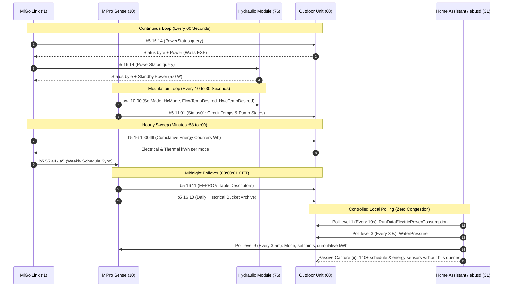
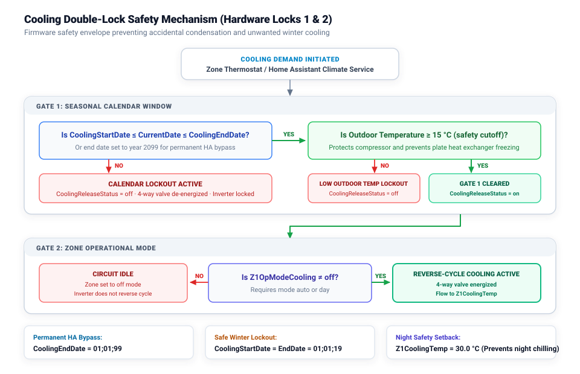
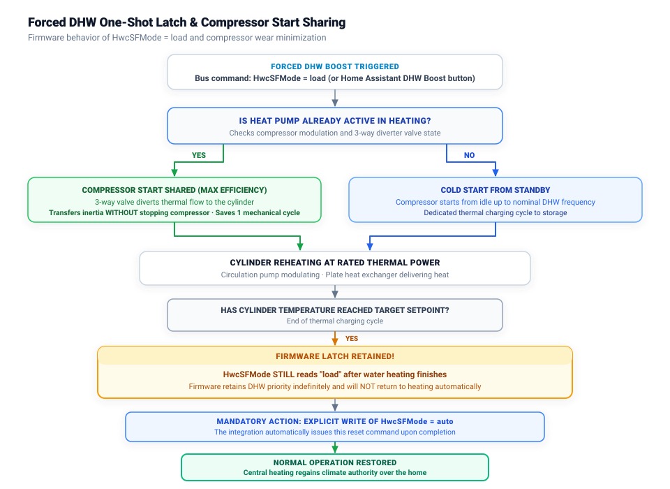

# Technical Reference & Reverse Engineering Documentation
## Saunier Duval Genia Air Max ES / Vaillant aroTHERM plus (eBUS Protocol)

This document provides a comprehensive technical breakdown of the reverse-engineered **eBUS** communication protocol for the latest generation of **monobloc R290 heat pumps** manufactured by the **Vaillant Group** (marketed interchangeably as **Saunier Duval Genia Air Max ES**, **Vaillant aroTHERM plus**, and related platform siblings equipped with the **MiPro Sense / sensoCOMFORT** climate controller and **MiGo Link / sensoNET** gateway).

---

## 1. Physical Layer, Network Topology & Address Matrix

The eBUS physical layer consists of an unshielded, reverse-polarity tolerant, two-wire serial bus running at **2,400 baud** (half-duplex, 8 data bits, 1 stop bit, no parity). It uses carrier-sense multiple access with collision detection (**CSMA/CD**) and bit-level priority arbitration.

### 1.1 Master-Slave Duality
In the eBUS specification, every physical intelligent micro-controller occupies two logical addresses:
- **Master Address:** Used to initiate arbitration, acquire the line, and transmit command telegrams or queries.
- **Slave Address:** Used to passively listen, acknowledge frames, and answer queries addressed to it.

The mandatory mathematical relationship between master and slave addresses is:
$$\text{Addr}_{\text{Slave}} = \text{Addr}_{\text{Master}} + 0\text{x}05$$

### 1.2 Hardware Identification & Device Map

A standard single-zone or multi-zone monobloc installation consists of the following bus participants:

| Master Addr | Slave Addr | Physical Hardware | Manufacturer Device ID | Active Configuration | Functional Role in System |
| :---: | :---: | :--- | :--- | :--- | :--- |
| **`03`** | **`08`** | Monobloc Outdoor Heat Pump Unit | `MF=Vaillant;ID=HMUX0` | `08.hmux0.csv` | Variable-speed inverter compressor, ECM evaporator fan, electronic expansion valve (EEV), 4-way reversing valve, hydraulic circuit pressure sensor, refrigerant thermodynamic probes, water-side heat meter. |
| **`10`** | **`15`** | Wall-Mounted Climate Controller | `MF=Vaillant;ID=BASS3` *(MiPro Sense / sensoCOMFORT)* | `15.bass3.csv` | Master system regulator, heating curve math, room ambient sensor, weekly schedule matrix (timers), DHW setpoints, holiday mode, installer configuration. |
| **`71`** | **`76`** | Indoor Hydraulic Station / Tower | `MF=Vaillant;ID=VWZIO` *(HPIM 7 / VWZ MEH 97/7)* | `76.vwzio.csv` | 3-way DHW diverter valve, secondary circulation pump, auxiliary electric backup heater stages, flow rate telemetry. |
| **`f1`** | **`f6`** | Wi-Fi / Ethernet Network Gateway | `MF=Vaillant;ID=NETX3` *(MiGo Link / sensoNET)* | `f6.netx3.csv` | Cloud gateway, NTP network time distribution, vendor mobile application backend polling engine. |
| **`ff`** | **`04`** | Gateway Application Interface | `MF=Vaillant;ID=NETX3` | `04.netx3.csv` | High-level diagnostic and broadcast channel used by the vendor cloud app. |
| **`31`** | **`36`** | Dedicated eBUSd Hardware Adapter | `ebusd` | *Internal daemon* | Local bridge interface, arbitration manager, and MQTT telemetry publisher. |

---

## 2. Bus Traffic Analysis, Device Communication Cycles & Periodicity

Understanding which device talks to which, what telegrams are exchanged, and their exact periodicity is critical to avoiding bus saturation on a narrow 2,400-baud line (maximum throughput: ~12 to 15 complete frames per second).

### 2.1 The Gateway Engine (`f1` / `NETX3`)
The vendor network gateway acts as a high-frequency polling master on the physical bus:
1. **The 60-Second Power Loop:** Every 60 seconds ($\pm 1\text{ s}$), `f1` queries `b5 16 14` from both `08` (outdoor unit) and `76` (hydraulic module). This telegram yields instantaneous power consumption in Watts and the operating mode byte.
2. **The Hourly Energy Sweep:** Around minute 58 to 00 of every hour, `f1` sweeps the cumulative IEEE 754 energy counters under `b5 16 1000ffff`, retrieving electrical and thermal Wh to upload hourly consumption bins to the vendor cloud.
3. **The Schedule Polling Sweep:** Periodically (and immediately whenever a user opens the official smartphone app), `f1` queries `b5 55 a4` (slot count) followed by `b5 55 a5` across circuits `00`, `01`, `02`, and `03` to synchronize weekly time programs.
4. **Broadcast Time Synchronization:** Broadcasts real-time UTC/local clock timestamps over the bus to keep all slave microcontrollers synchronized.

### 2.2 The Master Climate Regulator (`10` / `BASS3`)
The central controller manages thermodynamics, safety envelopes, and daily archiving:
1. **The Continuous Modulation Loop (10–30 s):** Sends command `uw_10 00` (`SetMode`) to the hydraulic module (`76`) and outdoor unit (`08`). This telegram contains the active system mode (`0=auto`, `1=off`, `2=heat`, `3=water`), the flow temperature target (`flowtempdesired`, encoded as `D1C`), the DHW target (`hwctempdesired`), and secondary circuit pump flags.
2. **Hydraulic Telemetry Reading (10–15 s):** Polls `b5 11 01` (`Status01`) from `76` and `08`, collecting flow, return, storage, outdoor temperatures, and pump status bytes (`0=off`, `1=on`, `2=overrun`, `4=hwc`).
3. **The Midnight EEPROM Rollover (`00:00:01` Daily):** At exactly one second past midnight, `10` emits command `b5 16 11` to inspect the EEPROM slot table, rotates the daily historical energy registers in `08` and `76`, writes the end-of-day total, and advances the 16-bit date stamp.

### 2.3 The Monobloc Heat Pump (`03` / `HMUX0`)
The outdoor inverter unit continuously processes internal safety and thermodynamic loops:
1. **Operational Telemetry (`b5 09 540200`):** Updates internal operational registers: compressor frequency (rps), inverter modulation, electronic expansion valve (EEV) step position, evaporator temperature, compressor inlet/discharge temperatures, and water-side heat output (`HmuHeatOutput`).
2. **System Broadcasts (`broadcast.tsp`):** Emits passive broadcast telegrams on system status and cooling release flags.

### 2.4 eBUSd & Home Assistant Pacing Strategy
Because `f1` and `10` already poll the bus heavily, an uncoordinated third-party integration querying hundreds of entities would immediately choke the bus. We designed a **four-tiered pacing strategy**:
- **Level 1 (`@poll(1)`):** Reserved strictly for **Real-Time Electric Power** (`RunDataElectricPowerConsumption` on `08.hmux0`). Rotates every ~10 seconds.
- **Level 2 (`@poll(3)`):** Reserved for **Water Circuit Pressure** (`WaterPressure`). Rotates every ~30 seconds.
- **Level 3 (`@poll(9)`):** Cumulative slow registers, outdoor temperature, and setpoints (~3.5 minutes per rotation).
- **Passive Listening (`u`):** All 140 weekly schedule entities (`*_Timer*`), EEPROM energy history counters, and `PowerStatus` registers have **zero active polling overhead**. They are captured passively from the queries that `f1` and `10` already emit on the bus.

---

## 3. High-Precision IEEE 754 Energy Telemetry (`b5 16`)

### 3.1 Frame Structure & Decoding Matrix
Energy telemetry commands follow an 8-byte request / 11-byte response structure:
- **Request (`QQ -> 08 / 76 / 15`):** `10 <period> ff ff <source> <usage> <packed_date_2B>`
- **Response (`11 Bytes`):** `<status_flags_3B> <source> <usage> <packed_date_2B> <energy_EXP_4B_Wh>`

#### Field Definitions:
- **`<period>`:**
  - `0x00`: **Cumulative Lifetime Total** (`total_increasing`).
  - `0x01`: Daily history slot.
  - `0x02`: Monthly history slot.
  - `0x03`: Yearly history slot.
- **`<source>`:** High nibble indicates energy direction (`0x80` = consumed/input, `0x40` = delivered/output):
  - `0x01`: Solar thermal energy (`StatSolarEnergySum`).
  - `0x02` / `0x42`: **Environmental yield extracted from outdoor air** (Wh).
  - `0x03` / `0x83`: **Electrical energy consumed** (Wh).
  - `0x04` / `0x84`: Fuel / gas energy (returns `0.0 Wh` on heat pumps).
  - `0x49`: **Thermal energy delivered** to water (Wh).
- **`<usage>` (Operational Circuit):**
  - `0x00`: Combined total across all modes.
  - `0x03`: **Heating Mode (`Hc`)**.
  - `0x04`: **Domestic Hot Water Mode (`Hwc`)**.
  - `0x05`: **Cooling Mode (`Cool`)**.
- **`<packed_date_2B>`:** 16-bit little-endian integer (`yyyyyyy mmmm ddddd`, year offset from 2000):
  - Example: `0x350d` (`0d35`) $\rightarrow$ `2026-08-13` (physical commissioning date).
  - Example: `0x3521` (`2135`) $\rightarrow$ `2026-09-01` (September monthly bucket).
  - Example: `0x3541` (`4135`) $\rightarrow$ `2026-10-01` (October monthly bucket).
- **`<energy_EXP_4B_Wh>`:** 32-bit single-precision IEEE 754 floating point in little-endian (`EXP`). Measured natively in **Watt-hours (`Wh`)**.

### 3.2 EEPROM Slot Table
The midnight descriptor query (`b5 16 11`) reports the internal non-volatile memory layout:
- **`08.hmux0` (Outdoor Monobloc):** Responds `02 0309 1009 3409 0a09` $\rightarrow$ **9 active slots (`00` to `08`)**, with ring buffers for 16 days (`0x10`), 52 months (`0x34`), and 10 years (`0x0a`).
- **`76.vwzio` (Hydraulic Module):** Responds `02 0304 1004 3404 0a04` $\rightarrow$ **4 active slots (`00` to `03`)**.

#### Complete Register Mapping Table:

| Circuit | Hex Subcommand | Slot | CSV Message Name | Physical Entity & Meaning | Native Unit |
| :--- | :--- | :---: | :--- | :--- | :---: |
| **`08.hmux0`** | `1000ffff 83 03 0000` | `00` | `PrEnergyElectricHc` | Cumulative Electrical Energy Consumed: **Heating** | `Wh` |
| **`08.hmux0`** | `1000ffff 42 03 0000` | `01` | `PrEnergyEnvYieldHc` | Cumulative Environmental Yield: **Heating** | `Wh` |
| **`08.hmux0`** | `1000ffff 49 03 0000` | `02` | `PrEnergyThermalHc` | Cumulative Thermal Energy Delivered: **Heating** | `Wh` |
| **`08.hmux0`** | `1000ffff 83 04 0000` | `03` | `PrEnergyElectricHwc`| Cumulative Electrical Energy Consumed: **DHW** | `Wh` |
| **`08.hmux0`** | `1000ffff 42 04 0000` | `04` | `PrEnergyEnvYieldHwc`| Cumulative Environmental Yield: **DHW** | `Wh` |
| **`08.hmux0`** | `1000ffff 49 04 0000` | `05` | `PrEnergyThermalHwc`| Cumulative Thermal Energy Delivered: **DHW** | `Wh` |
| **`08.hmux0`** | `1000ffff 83 05 0000` | `06` | `PrEnergyElectricCool`| Cumulative Electrical Energy Consumed: **Cooling** | `Wh` |
| **`08.hmux0`** | `1000ffff 42 05 0000` | `07` | `PrEnergyEnvYieldCool`| Environmental Yield: Cooling *(always 0 Wh)* | `Wh` |
| **`08.hmux0`** | `1000ffff 49 05 0000` | `08` | `PrEnergyThermalCool`| Cumulative Cooling Energy Extracted from Building | `Wh` |
| **`76.vwzio`** | `1000ffff 83 03 0000` | `00` | `PrEnergyElectricHc` | Secondary Electrical Energy: **Standby & Heating Backup** | `Wh` |
| **`76.vwzio`** | `1000ffff 49 03 0000` | `01` | `PrEnergyThermalHc` | Thermal Output from Indoor Backup Heater (COP = 1.0) | `Wh` |
| **`76.vwzio`** | `1000ffff 83 04 0000` | `02` | `PrEnergyElectricHwc`| Backup Electrical Energy Consumed for DHW | `Wh` |
| **`76.vwzio`** | `1000ffff 49 04 0000` | `03` | `PrEnergyThermalHwc`| Backup Thermal Energy Delivered for DHW | `Wh` |

### 3.3 Instantaneous Power Draw (`PowerStatus`, `b5 16 14`)
Polled every 60 seconds by `f1`:
- **Byte 0 (`status`, `UCH`):**
  - `0`: Standby.
  - `1`: Heating active.
  - `2`: DHW production active.
  - `3`: Cooling active.
- **Bytes 1..4 (`power`, `EXP`, Watts `W`):** Instantaneous active electrical power draw.
  - In standby, records the base electronics load: **`6.0 W`** on `08.hmux0` and **`5.0 W`** on `76.vwzio`.
  - In active operation, matches inverter wattmeter measurements dynamically (from ~400 W up to 3,500 W).

---

## 4. Compressor Dynamics, Modulation & Enthalpy Metering

### 4.1 Compressor Utilisation Divisor (`CompressorUtil`)
In diagnostic register block `b5 09 540200`, compressor modulation percentage is reported via data type `0x38` (decimal 56). Empirical testing across multiple units (Genia Air Max ES 15, aroTHERM plus VWL 35/6, aroTHERM plus VWL 55/8.1) proved that this register requires a **divisor of 16**:

$$\text{Compressor Utilisation (\%)} = \frac{\text{Raw Reading}}{16}$$

The relationship between compressor rotational speed ($f$ in rps) and utilisation follows:

$$\text{Utilisation (\%)} \approx 0.989 \times \text{rps} - 18.8$$

At the minimum operating frequency ($f_{\text{floor}} \approx 19\text{ rps}$), utilisation reads **$1.0\%$**. At $60\text{ rps}$, raw value `649` evaluates to:
$$\frac{649}{16} = \mathbf{40.56\%}$$
Matching real-time machine displays exactly.

### 4.2 Water-Side Heat Meter (`HmuHeatOutput`, `0D5E`)
Register `0D5E` decodes as an internal enthalpy heat meter in Watts (`W`). Independent validation against calibrated flow meters and precision flow/return temperature sensors ($P = Q \times \Delta T \times 1.163$):
- Calculated physical heat output: **3,710 W**
- Register `0D5E` readout: **3,680.65 W**
- Discrepancy: **$0.8\%$**

This proves `0D5E` provides a laboratory-grade thermal power measurement on the water side of the plate heat exchanger.

### 4.3 Refrigeration Loop Telemetry Block (`08.hmux0`)
The following sub-registers under `b5 09 540200` provide low-level refrigeration cycle diagnostics:
- **`09C5`:** Primary circulation pump PWM modulation and power.
- **`0A28`:** Electronic Expansion Valve (EEV) absolute step position (0 to 500 steps).
- **`0A47`:** ECM Evaporator Fan 1 speed (rpm).
- **`0A30`:** ECM Evaporator Fan 2 speed (rpm, on twin-fan chassis).
- **`10D1`:** Evaporator saturation temperature ($1/16\ ^\circ\text{C}$).
- **`10D7`:** Current suction line superheat ($1/16\text{ K}$): verifies directly against `RunDataCompressorInletTemp` minus `10D1`.
- **`10DB`:** Condenser liquid outlet temperature ($1/16\ ^\circ\text{C}$).

---

## 5. Weekly Schedule & Multi-Timer Programming (`b5 55` / `b5 a5/a6`)

The climate regulator (`15.bass3`) manages weekly schedules across 4 distinct functional circuits:
- **Circuit `03`:** Heating Zone 1 (`Z1Timer`)
- **Circuit `02`:** Domestic Hot Water (`HwcTimer`)
- **Circuit `01`:** Active Cooling (`CoolingTimer`)
- **Circuit `00`:** DHW Circulation Pump (`CirculationTimer`)

### 5.1 Slot Count Query (`b5 55 a4`)
Query: `f1 15 b555 03 a4 00 <circuit>`  
Response: `09 00 <mon_slots> <tue_slots> <wed_slots> <thu_slots> <fri_slots> <sat_slots> <sun_slots> 00`  
Each day byte returns an integer ($0$ to $3$) representing how many time windows are currently programmed.

### 5.2 Slot Read (`b5 55 a5`) & Write (`b5 55 a6`)
- **Read:** Addressed by day (`00` = Monday .. `06` = Sunday) and slot index (`00` .. `02`).
  - Fields: `from_hour (UCH)`, `from_min (UCH)`, `to_hour (UCH)`, `to_min (UCH)`, `cooling_temp (D1C, circuit 01 only)`, `ignore (HEX:2 = FFFF)`.
- **Write Telegram Structure:**
  `f1 15 b555 0c a6 ff <circuit> <day> <slot> <total_slots> <from_hour> <from_min> <to_hour> <to_min> ff ff`
- **Critical `=FFFF` Constraint:** The terminal 2 bytes must be written as `0xFFFF`. Any attempt to pass null padding or omit these bytes causes the microcontroller to drop the telegram without updating EEPROM.

---

## 6. Hardware Locks, Safety Latches & Special Modes

### 6.1 The Cooling Double-Lock Safety Mechanism
To protect radiant floor installations from condensation damage and prevent accidental chilling in winter, the firmware enforces two sequential gates:

  

#### Gate 1: Seasonal Calendar Lock (`CoolingStartDate` & `CoolingEndDate`)
- The internal calendar gate is active when:
  $$\text{CoolingStartDate} \le \text{CurrentDate} \le \text{CoolingEndDate}$$
- If today's date falls outside this window, `CoolingReleaseStatus` reports `off` (`0`) and the compressor inverter is hard-locked against reverse-cycle operation.
- **Home Assistant Indefinite Bypass:** Setting `CoolingEndDate` to `01;01;99` (January 1, 2099) permanently unlocks Gate 1, transferring seasonal authority to Home Assistant.
- **Winter Lockout Reset:** Writing `01;01;19` to both dates immediately restores the firmware hardware lockout.

#### Gate 2: Operational Mode & Base Setpoint
- `Z1OpModeCooling`: `off`, `auto` (follows `CoolingTimer`), `day` (continuous manual cooling).
- `Z1CoolingTemp`: Base setback target outside active time slots. Setting this to **30.0 °C** guarantees the unit will never run cooling cycles at night or during expensive peak tariff hours.

### 6.2 The Forced DHW One-Shot Latch (`HwcSFMode = load`)

  

- **Latch Behavior:** Writing `load` to `ctlv3/HwcSFMode` or `bass3/HwcSFMode` forces an immediate DHW cylinder recharge. However, **this register does NOT clear itself back to `auto`** upon reaching setpoint. It acts as an operational latch; if not explicitly cleared by the caller, the system remains in DHW priority indefinitely.
- **Efficiency Optimization (Compressor Start Sharing):** Triggering `HwcSFMode = load` while the heat pump is already running in space heating diverts the 3-way valve directly to the water cylinder. This transfers thermal inertia without stopping the compressor, saving a mechanical start cycle and preserving compressor bearing life.

### 6.3 Smart Forced DHW Boost Algorithm
In Vaillant firmware, `CylinderChargeHyst` enforces a minimum drop of $5.0\text{ K}$ (or installer configurable $3.0\text{ K}$ to $10.0\text{ K}$) before heating engages. If the cylinder is at $51\ ^\circ\text{C}$ and target is $55\ ^\circ\text{C}$, a manual boost command would normally be rejected because:
$$T_{\text{storage}} > T_{\text{target}} - \text{Hysteresis} \quad (51 > 55 - 5 = 50)$$

Our smart boost algorithm calculates a dynamic temporary setpoint:
$$T_{\text{boost}} = T_{\text{storage}} + \text{Hysteresis} + 1.5\ ^\circ\text{C}$$
It writes this temporary setpoint to `HwcTempDesired`, fires `HwcSFMode = load`, waits for the compressor to engage, and automatically restores the original setpoint once completed.

### 6.4 Anti-Sentinel Temperature Filtering
When space heating or cooling is disabled, the firmware emits sentinel values into the target setpoint registers:
- Heating off: setpoint drops to **$5.0\ ^\circ\text{C}$** (anti-frost sentinel).
- Cooling off: setpoint jumps to **$99.0\ ^\circ\text{C}$** or drops to **$5.0\ ^\circ\text{C}$**.

Exposing raw values directly to Home Assistant causes thermostat cards to violently oscillate. The integration implements a stateful filter: it caches the user's legitimate comfort setpoint in internal memory and exposes `HVACMode.OFF` without corrupting the target temperature display.

---

## 7. Probe Standardization for Absent Sensors (`tempv` + `IGN:4`)

In many installations, optional sensor inputs (such as solar collector probes, swimming pool heat exchanger sensors, or secondary buffer tank probes) are physically unpopulated:
- If unpopulated inputs are mapped with standard signed/unsigned temperature types (`D1C` or `D2C`), the microcontroller emits `0x00 0xFF` or invalid error frames, causing eBUSd to output corrupted values (`-99 °C` or `3276.7 °C`).
- **Standard Implementation:** All optional probes in `15.bass3.tsp` are defined using the special type **`tempv`** accompanied by a 4-byte echo padding (`ign: IGN:4`). The `tempv` decoder checks the hardware sensor validity flag; when open-circuit, eBUSd cleanly returns `-` (null), allowing Home Assistant to treat the sensor as gracefully absent without log warnings.

---

## 8. Software Concurrency & Bus Collision Prevention

At 2,400 baud, concurrent write commands collide immediately, causing physical framing errors (`ERR: arbitration lost`, `ERR: SYN received`).

The Home Assistant integration incorporates an **asynchronous serialization engine**:
1. **Global Async Lock:** All write telegrams acquire an internal `asyncio.Lock()`.
2. **Read-After-Write Verification:** After issuing any write command, the coordinator waits a minimum pacing interval (`0.8 s`), issues a read command to verify that the microcontroller's EEPROM accepted the new value, and only then releases the lock for subsequent operations.
3. **Write Debouncing:** Rapid UI adjustments (e.g. dragging a temperature slider) are debounced so only the final settled setpoint is dispatched to the physical bus.

---

## 9. Passive Device Metadata & Serial Number Extraction

Rather than polling manufacturer serial numbers across the bus, the integration listens to the retained MQTT discovery topics emitted by `ebusd`:
- **Topic:** `ebusd/scan.<circuit>/id`
- **Payload Format:** `MF=Vaillant;ID=HMUX0;SW=0407;HW=0504;...`

The parser extracts:
1. **28-Character Barcode Serial Number:** Formatted as `21YYWWPPPPSSSSSSSSNNNNNNNNNN` (Brand prefix `21`, country `22`, production year/week, manufacturing plant, and unit sequence).
2. **Firmware Version (`sw_version`):** Automatically registers as `SW 04.07`.
3. **Hardware Revision (`hw_version`):** Automatically registers as `HW 05.04`.

This populates the Home Assistant Device Registry natively with zero active bus queries.
