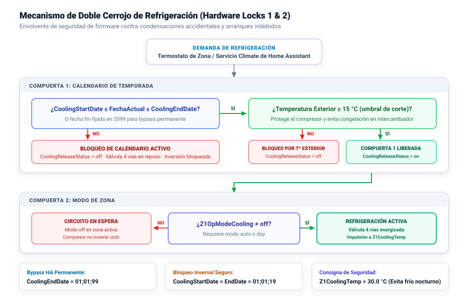
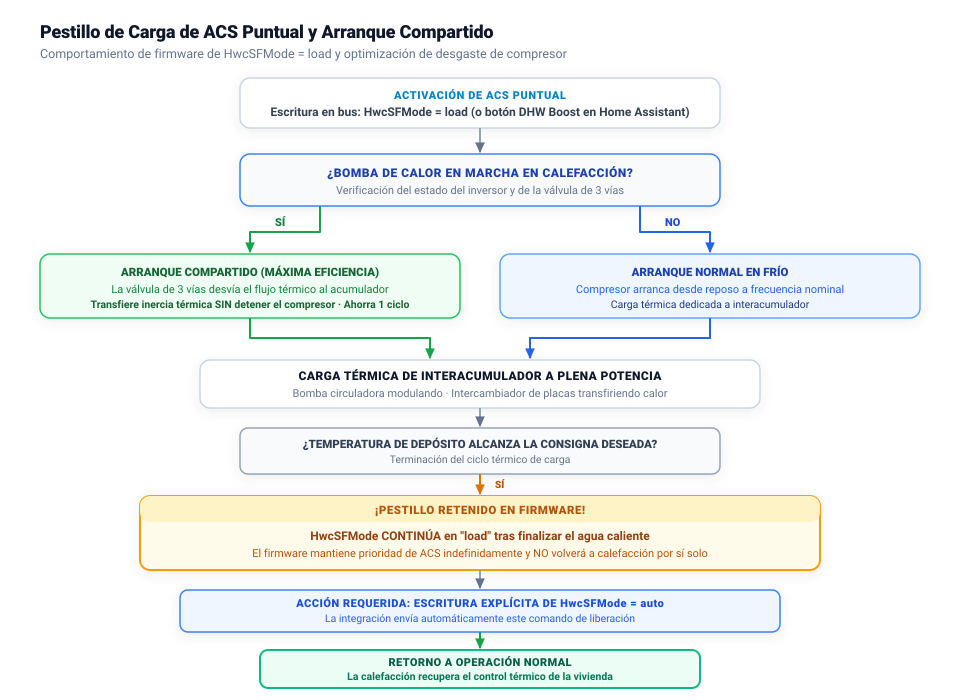

# Referencia Técnica e Ingeniería Inversa del Protocolo eBUS
## Saunier Duval Genia Air Max ES / Vaillant aroTHERM plus

[🇬🇧 Read in English](technical_reference.md) | **🇪🇸 Español**

Este documento recoge el desglose técnico del protocolo de comunicación **eBUS** obtenido mediante ingeniería inversa para las **bombas de calor aire-agua con refrigerante R290** del **Grupo Vaillant** (comercializadas indistintamente como **Saunier Duval GeniaAir Max**, **Vaillant aroTHERM plus** y variantes equipadas con reguladores **MiPro Sense / sensoCOMFORT / sensoHOME** y pasarelas **MiGo Link / sensoNET / myVAILLANT connect**).

---

## 1. Capa Física, Topología del Bus y Asignación de Direcciones

La capa física de eBUS consiste en un bus serie bifilar, no apantallado y con tolerancia a inversión de polaridad que opera a **2.400 baudios** (semidúplex, 8 bits de datos, 1 bit de parada, sin paridad). Emplea acceso múltiple con escucha de portadora y detección de colisiones (**CSMA/CD**) con arbitraje de prioridad a nivel de bit.

### 1.1 Dualidad Maestro / Esclavo
En la especificación de eBUS, cada microcontrolador físico inteligente ocupa obligatoriamente dos direcciones lógicas:
- **Dirección Maestro (Master):** Utilizada para arbitrar el bus, tomar la palabra y transmitir órdenes o consultas.
- **Dirección Esclavo (Slave):** Utilizada para escuchar pasivamente, responder a consultas y recibir parámetros dirigidos a él.

La relación matemática fija e inmutable entre ambas direcciones es:
$$\text{Dir}_{\text{Slave}} = \text{Dir}_{\text{Master}} + 0\text{x}05$$

### 1.2 Identificación de Hardware y Mapa de Dispositivos

Una instalación estándar consta de los siguientes participantes en el bus:

| Dirección Master | Dirección Slave | Dispositivo Físico | Identificador de Firmware | Archivo CSV Activo | Función en la Instalación |
| :---: | :---: | :--- | :--- | :--- | :--- |
| **`03`** | **`08`** | Unidad Exterior (Bomba de Calor) | `MF=Vaillant;ID=HMUX0`<br>`MF=Vaillant;ID=HMU00` | `08.hmux0.csv`<br>`08.hmu.csv`<br>`08.hmu.HW5103.csv` | Compresor inverter de velocidad variable, ventilador modulante ECM, válvula de expansión electrónica (EEV), válvula de 4 vías de inversión de ciclo, presostato/sensor de presión de agua, sondas frigoríficas de refrigerante R290, calorímetro de agua y acumulador de integral de energía. |
| **`10`** | **`15`** | Regulador Climático de Pared | `MF=Vaillant;ID=BASS3`<br>`MF=Vaillant;ID=BASV3`<br>`MF=Vaillant;ID=CTLV2`<br>`MF=Vaillant;ID=CTLV3`<br>*(MiPro Sense / sensoCOMFORT)* | `15.bass3.csv`<br>`15.basv3.csv`<br>`15.ctlv2.csv`<br>`15.ctlv3.csv` | Regulador maestro del sistema, cálculo de curva de calefacción, sonda de temperatura y humedad ambiente de sala, matriz de programación horaria semanal (`b5 55` con 3 franjas diarias), consignas de ACS y antilegionela, cerrojos de refrigeración y modo vacaciones. |
| **`71`** | **`76`** | Módulo Hidráulico Interior / Torre | `MF=Vaillant;ID=VWZIO`<br>*(HPIM 7 / MEH 97/7 / uniTOWER / GeniaSet)* | `76.vwzio.csv` | Válvula de 3 vías de derivación a ACS, bomba circuladora secundaria de impulsión, etapas de apoyo eléctrico (si existen), telemetría hidráulica (`StationState`) y relé multifunción (recirculación de ACS). |
| **`f1`** | **`f6`** | Pasarela de Comunicaciones Wi-Fi | `MF=Vaillant;ID=NETX3`<br>`MF=Vaillant;ID=NETX2`<br>*(MiGo Link / sensoNET)* | `f6.netx3.csv` | Conexión con los servidores en la nube del fabricante, sincronización horaria NTP y motor de sondeo de la aplicación móvil oficial. |
| **`ff`** | **`04`** | Interfaz de Aplicación / Receptor RF | `MF=Vaillant;ID=NETX3` | `04.netx3.csv` | Telemetría del dial inalámbrico y canal broadcast/diagnóstico usado por termostatos RF opcionales y pasarelas oficiales. |
| **`31`** | **`36`** | Adaptador eBUSd Físico | `ebusd` | *Interno* | Puente local hacia el broker MQTT y Home Assistant, con servidor TCP opcional de diagnósticos físicos (puerto por defecto `8888`). |

---

## 2. Análisis del Tráfico del Bus, Ciclos de Comunicación y Periodicidad

Comprender qué dispositivo habla con quién, qué telegramas se intercambian y con qué periodicidad exacta es esencial para evitar el colapso del bus a 2.400 baudios (capacidad máxima: ~12 a 15 tramas completas por segundo).

```mermaid
sequenceDiagram
    autonumber
    participant F1 as MiGo Link (f1)
    participant BASS as MiPro Sense (10)
    participant VWZ as Módulo Hidráulico (76)
    participant HMU as Unidad Exterior (08)
    participant EBUS as Home Assistant / ebusd (31)

    Note over F1,HMU: Bucle Continuo (Cada 60 Segundos)
    F1->>HMU: b5 16 14 (Consulta PowerStatus)
    HMU-->>F1: Byte de Estado + Potencia (Vatios EXP)
    F1->>VWZ: b5 16 14 (Consulta PowerStatus)
    VWZ-->>F1: Byte de Estado + Potencia Standby (5.0 W)

    Note over BASS,VWZ: Bucle de Modulación (Cada 10 a 30 Segundos)
    BASS->>VWZ: uw_10 00 (SetMode: HcMode, FlowTempDesired, HwcTempDesired)
    BASS->>HMU: b5 11 01 (Status01: Temperaturas y Estado de Bombas)

    Note over F1,HMU: Barrido Horario (Minutos :58 a :00)
    F1->>HMU: b5 16 1000ffff (Acumuladores de Energía Wh)
    HMU-->>F1: Wh eléctricos y térmicos por modo
    F1->>BASS: b5 55 a4 / a5 (Sincronización de Horarios)

    Note over BASS,HMU: Cierre Diario de Medianoche (00:00:01 CET)
    BASS->>HMU: b5 16 11 (Descriptores de Tabla EEPROM)
    BASS->>HMU: b5 16 10 (Cierre y Rotación de Cubos Diarios)

    Note over EBUS,HMU: Sondeo Local Controlado (Baja Carga de Bus)
    EBUS->>HMU: Nivel 1 (r1;u): RunDataElectricPowerConsumption
    EBUS->>HMU: Nivel 2 (r2;u): RunDataFlowTemp, RunDataReturnTemp, RunDataFlowRate
    EBUS->>BASS: Nivel 9 (r9;u): Modos, consignas, acumuladores y presiones
    EBUS--)HMU: Captura Pasiva (u / r;u): 140+ registros horarios, StateCompressor y PowerStatus
```

### 2.1 El Motor de la Pasarela (`f1` / `NETX3`)
Cuando existe una pasarela oficial en el bus, actúa como maestro de sondeo:
1. **El Bucle de Potencia de 60 Segundos:** Cada 60 segundos ($\pm 1\text{ s}$), `f1` consulta `b5 16 14` (`PowerStatus`) a `08` (unidad exterior) y a `76` (módulo hidráulico). Este telegrama reporta la potencia eléctrica instantánea en Vatios y el byte de modo operativo.
2. **El Barrido Horario de Energía:** Alrededor del minuto 58 a 00 de cada hora, `f1` realiza un barrido de los contadores IEEE 754 bajo `b5 16 1000ffff`, recolectando los Wh eléctricos y térmicos para alimentar los cubos horarios de la nube.
3. **El Barrido de Programaciones Horarias:** Periódicamente (y siempre que el usuario abre la aplicación móvil oficial), `f1` consulta `b5 55 a4` (conteo de franjas) seguido de `b5 55 a5` en los circuitos horarios (`00`..`04`) para sincronizar los calendarios semanales.
4. **Sincronización Horaria Broadcast:** Transmite tramas de sincronización horaria para mantener en hora todos los relojes esclavos del bus.

### 2.2 El Regulador Climático Maestro (`10` / `BASS3` / `BASV3` / `CTLV2` / `CTLV3`)
La centralita de pared gobierna la termodinámica, las curvas de calefacción y el cierre diario:
1. **El Bucle de Modulación Continuo (10–30 s):** Envía el comando `uw_10 00` (`SetMode`) al módulo hidráulico (`76`) y a la unidad exterior (`08`). Este telegrama fija el modo del sistema (`0=auto`, `1=off`, `2=heat`, `3=water`), la consigna de impulsión calculada (`flowtempdesired`, en formato `D1C`), la consigna de ACS (`hwctempdesired`) y los estados de bomba.
2. **Lectura Hidráulica Continua (10–15 s) y Estado de Compresor (60 s):** Consulta `b5 11 01` (`Status01`) a `76` y `08` cada 10–15 s, recopilando temperaturas de impulsión, retorno, interacumulador, exterior y estado de bombas (`0=off`, `1=on`, `2=overrun`, `4=hwc`), y consulta `b5 11 00` (`StateCompressor`) a `08` cada 60 s para conocer el estado operativo del compresor y su modulación.
3. **El Cierre de Medianoche en EEPROM (`00:00:01` Diario):** A un segundo de la medianoche, `10` emite el comando descriptor `b5 16 11`, rota los cubos diarios de energía en la EEPROM de `08` y `76`, fija el balance del día anterior y avanza la fecha empaquetada de 16 bits.

### 2.3 La Unidad Exterior (`03` / `HMUX0` / `HMU00`)
Procesa continuamente sus lazos internos de seguridad y refrigeración:
1. **Telemetría Operativa (`b5 09 540200` / `b5 1a`):** Actualiza sus registros internos: velocidad del compresor (rps), modulación inverter, pasos de la válvula de expansión (EEV), temperatura de evaporación, temperaturas de entrada/descarga del compresor y calorímetro de agua (`HmuHeatOutput`).
2. **Difusiones Broadcast (`broadcast.csv`):** Emite y recibe telegramas pasivos (`fe b5 05` / `fe b5 16` / `fe 07 00`) con fecha/hora del bus, temperatura exterior (`Outsidetemp`) y ciclo activo de refrigeración (`CoolingStatus`).

### 2.4 Estrategia de Sondeo de eBUSd y Home Assistant
Dado que `10` (y `f1`, si está presente) ya generan tráfico continuo, los archivos CSV incluidos utilizan una **política en tres niveles de prioridad** calibrada sobre el ciclo `--pollinterval=5` por defecto de `ebusd`:
- **Nivel 1 (`r1;u`):** Exclusivo para la **Potencia Eléctrica Instantánea** (`RunDataElectricPowerConsumption` en `08.hmux0.csv`, `08.hmu.csv` y `08.hmu.HW5103.csv`). Garantiza actualizaciones cada ~9–18 segundos sin depender de ninguna pasarela cloud.
- **Nivel 2 (`r2;u`):** Reservado estrictamente para el **Salto Térmico ΔT y Potencia Térmica en Vivo** (`RunDataFlowTemp`, `RunDataReturnTemp` y `RunDataFlowRate` en todos los CSV exteriores), actualizando cada ~18–36 segundos para obtener ΔT, W y COP/EER ágiles.
- **Nivel 9 (`r9;u`):** Sondeo de baja frecuencia para acumuladores lentos, presiones y temperaturas del circuito frigorífico, nivel silencioso (`CompressorSilentOperationLevel`), integral de energía (`EnergyIntegral`), registros de Quick Veto (`Z1QuickVetoTemp`, `Z1QuickVetoDuration`) y totales energéticos del regulador / HMU.
- **Escucha Pasiva (`u` y `r;u`):** Más de 140 registros de franjas horarias semanales (`*_Timer*`), `StateCompressor` (`b5 11 00`), `StationState` (`b5 12 0f0613`), contadores EEPROM `b5 16` y `PowerStatus` (`b5 16 14`) no añaden sondeos periódicos cuando están en reposo, aprovechando el tráfico ya existente de `10` y `f1`. Cuando no hay pasarela oficial (`f1` desactivado), Home Assistant activa un bucle de respaldo escalonado (`/get`) para los registros principales (`fallback_poll_interval`, por defecto `300 s`).

---

## 3. Telemetría de Energía de Alta Precisión (`b5 16`)

### 3.1 Estructura de Trama y Matriz de Decodificación
Todas las consultas de energía utilizan 8 bytes de petición y 11 bytes de respuesta:
- **Petición (`QQ -> 08 / 76 / 15`):** `10 <periodo> ff ff <fuente> <uso> <fecha_empaquetada_2B>`
- **Respuesta (`11 Bytes`):** `<flags_estado_3B> <fuente> <uso> <fecha_empaquetada_2B> <energia_EXP_4B_Wh>`

#### Definición de Campos:
- **`<periodo>`:**
  - `0x00`: **Total Acumulado de Por Vida** (`total_increasing`).
  - `0x01`: Histórico diario.
  - `0x02`: Histórico mensual.
  - `0x03`: Histórico anual.
- **`<fuente>`:** El nibble alto define el sentido del flujo energético (`0x80` = consumida/entrada, `0x40` = entregada/salida):
  - `0x01`: Energía solar térmica (`StatSolarEnergySum`).
  - `0x02` / `0x42`: **Rendimiento ambiental extraído del aire exterior** (Wh).
  - `0x03` / `0x83`: **Energía eléctrica consumida** (Wh).
  - `0x04` / `0x84`: Energía de gas/combustible (devuelve `0.0 Wh` en aerotermia pura).
  - `0x49`: **Energía térmica/frigorífica útil entregada** al agua (Wh).
- **`<uso>` (Circuito / Modo Operativo):**
  - `0x00`: Suma combinada de todos los modos.
  - `0x03`: **Calefacción (`Hc`)**.
  - `0x04`: **Agua Caliente Sanitaria (`Hwc`)**.
  - `0x05`: **Refrigeración (`Cool`)**.
- **`<fecha_empaquetada_2B>`:** Entero little-endian de 16 bits (`yyyyyyy mmmm ddddd`, año base 2000):
  - Ejemplo: `0x350d` (`0d35`) $\rightarrow$ `2026-08-13` (fecha de puesta en marcha física).
  - Ejemplo: `0x3521` (`2135`) $\rightarrow$ `2026-09-01` (cubo mensual de septiembre).
  - Ejemplo: `0x3541` (`4135`) $\rightarrow$ `2026-10-01` (cubo mensual de octubre).
- **`<energia_EXP_4B_Wh>`:** Número en coma flotante simple IEEE 754 de 32 bits little-endian (`EXP`). La unidad física nativa es el **Vatio-hora (`Wh`)**.

### 3.2 Tabla de Ranuras EEPROM (`08.hmux0` y `76.vwzio`) y Respaldo en `HMU00`
El comando descriptor nocturno (`b5 16 11`) reporta la distribución de la memoria no volátil en placas Monobloc:
- **`08.hmux0` (Unidad Exterior):** Responde `02 0309 1009 3409 0a09` $\rightarrow$ **9 ranuras activas (`00` a `08`)**, con buffers circulares para 16 días (`0x10`), 52 meses (`0x34`) y 10 años (`0x0a`).
- **`76.vwzio` (Módulo Hidráulico):** Responde `02 0304 1004 3404 0a04` $\rightarrow$ **4 ranuras activas (`00` a `03`)**.

#### Tabla Completa de Mapeo de Registros:

| Circuito | Subcomando Hex | Ranura | Nombre en CSV | Magnitud Física y Significado Real | Unidad |
| :--- | :--- | :---: | :--- | :--- | :---: |
| **`08.hmux0`** | `1000ffff 83 03 0000` | `00` | `PrEnergyElectricHc` | Consumo eléctrico acumulado: **Calefacción** | `Wh` |
| **`08.hmux0`** | `1000ffff 42 03 0000` | `01` | `PrEnergyEnvYieldHc` | Rendimiento ambiental acumulado: **Calefacción** | `Wh` |
| **`08.hmux0`** | `1000ffff 49 03 0000` | `02` | `PrEnergyThermalHc` | Energía térmica útil entregada: **Calefacción** | `Wh` |
| **`08.hmux0`** | `1000ffff 83 04 0000` | `03` | `PrEnergyElectricHwc`| Consumo eléctrico acumulado: **ACS** | `Wh` |
| **`08.hmux0`** | `1000ffff 42 04 0000` | `04` | `PrEnergyEnvYieldHwc`| Rendimiento ambiental acumulado: **ACS** | `Wh` |
| **`08.hmux0`** | `1000ffff 49 04 0000` | `05` | `PrEnergyThermalHwc`| Energía térmica útil entregada: **ACS** | `Wh` |
| **`08.hmux0`** | `1000ffff 83 05 0000` | `06` | `PrEnergyElectricCool`| Consumo eléctrico acumulado: **Refrigeración** | `Wh` |
| **`08.hmux0`** | `1000ffff 42 05 0000` | `07` | `PrEnergyEnvYieldCool`| Rendimiento ambiental: Frío *(siempre 0 Wh)* | `Wh` |
| **`08.hmux0`** | `1000ffff 49 05 0000` | `08` | `PrEnergyThermalCool`| Energía frigorífica extraída de la vivienda | `Wh` |
| **`76.vwzio`** | `1000ffff 83 03 0000` | `00` | `PrEnergyElectricHc` | Consumo eléctrico: **Standby y Apoyo Interior** | `Wh` |
| **`76.vwzio`** | `1000ffff 49 03 0000` | `01` | `PrEnergyThermalHc` | Energía térmica entregada por resistencia interna (COP 1) | `Wh` |
| **`76.vwzio`** | `1000ffff 83 04 0000` | `02` | `PrEnergyElectricHwc`| Consumo eléctrico de apoyo para ACS | `Wh` |
| **`76.vwzio`** | `1000ffff 49 04 0000` | `03` | `PrEnergyThermalHwc`| Energía térmica de apoyo para ACS | `Wh` |

> **Respaldo en Unidades Split / `HMU00` (`HW=5103`) y Corrección `ULG` de 32 bits:** Las unidades `08.hmu` / `08.hmu.HW5103` carecen de las 9 ranuras EEPROM `b5 16`. En ellas la integración recurre a los acumuladores eléctricos `PrEnergySum*` del regulador (`b5 24`, `ULG`, `kWh`) combinados con los contadores `b5 1a` de la unidad exterior (`YieldHc`, `YieldHwc`, `TotalEnergyUsage` — corregidos de `UIN` de 16 bits a `ULG` de 32 bits en `08.hmu*.csv` para evitar el desbordamiento a 65.535 kWh) y los registros nativos `CopHc` / `CopHwc` / `CopCooling`.

### 3.3 Potencia Instantánea (`RunDataElectricPowerConsumption` y `PowerStatus`)
Home Assistant obtiene la potencia eléctrica instantánea combinando dos fuentes complementarias:
1. **Fuente Primaria Activa — `RunDataElectricPowerConsumption` (`b5 09 5402005b0d`, `r1;u`, `EXP` Vatios):** Sondeado activamente con prioridad máxima (`r1`) en `08.hmux0` y `08.hmu` sin depender de pasarela cloud. Se prioriza siempre que su antigüedad sea `<= 180 s`.
2. **Respaldo Dinámico — `PowerStatus` (`b5 16 14`, `r;u`):** Consultado cada 60 segundos por `f1` (si está presente):
   - **Byte 0 (`status`, `UCH`):** `0` = Reposo, `1` = Calefacción activa, `2` = Producción de ACS activa, `3` = Refrigeración activa.
   - **Bytes 1..4 (`power`, `EXP`, Vatios `W`):** Consumo basal en reposo (~`6,0 W` en `08.hmux0` y `5,0 W` en `76.vwzio`) y potencia en marcha del compresor.
   - Si ni `RunDataElectricPowerConsumption` ni `PowerStatus` reciben actualizaciones durante `600 s` (`10 min`), tanto la potencia eléctrica en vivo como el COP instantáneo pasan de forma segura a `no disponible` (*unavailable*).

---

## 4. Dinámica del Compresor, Modulación y Calorimetría

### 4.1 Decodificación de los 9 Bytes de `StateCompressor` (`b5 11 00`)
Cada 60 segundos, la centralita (`10`) consulta el registro `b5 11 00` (`StateCompressor`) a la unidad exterior (`08`), que responde con una trama de 9 bytes `[b0, b1, b2, b3, b4, b5, b6, b7, b8]`. El contraste empírico en vivo en modos de reposo, preventilación, calefacción, ACS, refrigeración y post-circulación reveló la estructura exacta de cada byte:

| Posición de Byte | Campo en CSV | Tipo de Dato | Magnitud Física y Comportamiento Verificado |
| :---: | :--- | :---: | :--- |
| **`0..1`** (`b0, b1`) | `flow_temp` | `D2C` (`°C`) | **Temperatura de impulsión en $1/16\ ^\circ\text{C}$** ($\text{Raw} / 16 = \text{RunDataFlowTemp}$). P. ej., un valor raw de `598` equivale a $37,375\ ^\circ\text{C}$. *(Anteriormente identificado erróneamente como RPM de 16 bits, razón por la cual marcaba `330–650` incluso en reposo).* |
| **`2`** (`b2`) | `ign` | `IGN:1` | Byte de estado interno (`0x0e`..`0x10` / decimal `14`..`16`). |
| **`3`** (`b3`) | `modulation` | `UCH` (`%`) | **Modulación Real del Compresor (`0–102 %`)**. Marca `0 %` en reposo, preventilación y post-circulación, y `25 %..102 %` con el compresor en marcha. *(Agrupar `b2..b3` como `UIN` de 16 bits desplazaba antes `b3` al byte alto: $16 + 256 \times b_3$).* |
| **`4`** (`b4`) | `mode_flags` | `UCH` | **Máscara de modo operativo y válvula desviadora**: `0` = reposo, `1..4` = calefacción, `21..24` = ACS, `31` = post-circulación, `100..104` = refrigeración. |
| **`5..8`** (`b5..b8`) | `state_bytes` | `HEX:4` | **Estado Hardware del Compresor y Espejo de Modulación**:<br>• **`b5` (1.er byte):** `0x00` = reposo, `0x08` = bomba en preventilación/post-circulación (compresor **APAGADO**), `0x09` = **compresor ENCENDIDO** (Calefacción, ACS o Refrigeración).<br>• **`b6..b7`:** `00 00`.<br>• **`b8` (4.º byte):** Espejo hexadecimal exacto de `b3` (`0x00` apagado; `0x19`..`0x66` = `25 %..102 %` en marcha). |

### 4.2 El Divisor de Utilización del Compresor (`CompressorUtil`)
En el bloque de diagnóstico `b5 09 540200`, la modulación porcentual del compresor se transmite con el tipo de datos `0x38` (56 en decimal). Las pruebas empíricas cruzadas en diferentes modelos de la plataforma demostraron que requiere un **divisor de 16**:

$$\text{Utilización (\%)} = \frac{\text{Valor Raw}}{16}$$

La relación matemática entre la velocidad de rotación ($f$ en rps) y el porcentaje de modulación sigue la recta:

$$\text{Utilización (\%)} \approx 0.989 \times \text{rps} - 18.8$$

A la velocidad mínima de rotación ($f_{\text{corte}} \approx 19\text{ rps}$), la utilización reporta **$1,0\%$**. A $60\text{ rps}$, el valor raw `649` arroja:
$$\frac{649}{16} = \mathbf{40,56\%}$$
Coincidiendo con exactitud con los menús de instalador de la máquina.

### 4.3 Calorímetro de Agua Integrado (`HmuHeatOutput`, `0D5E`)
El registro `0D5E` decodifica la potencia térmica útil en Vatios (`W`). La validación frente al cálculo termodinámico mediante caudalímetro calibrado y sondas de ida/retorno ($P_{\text{term}} = Q \times \Delta T \times 1.163$):
- Potencia física calculada: **3.710 W**
- Valor en el registro `0D5E`: **3.680,65 W**
- Discrepancia: **$0,8\%$**

Esto confirma que `0D5E` actúa como un contador de calor de alta precisión en el lado de agua del intercambiador de placas.

### 4.4 Telemetría Frigorífica, Hidráulica y de Regulador (`08.hmux0`, `76.vwzio`, `15.*`)
Sub-registros clave decodificados en las tres placas principales:
- **`09C5` (`08`, `540200c509`):** Modulación PWM y potencia de la bomba circuladora primaria (`EXP`, `%`).
- **`0A28` (`08`, `540200280a`):** Posición absoluta de pasos de la Válvula de Expansión Electrónica EEV (`0` a `500` pasos).
- **`0A47` / `0A30` (`08`):** Velocidad de los ventiladores 1 / 2 del evaporador (`rpm`).
- **`0B09` (`08`, `540200090b`, `r2;u`):** Caudal volumétrico de agua en tiempo real (`RunDataFlowRate`, `UIN`, `l/h`) medido por el caudalímetro vórtex primario (`0 l/h` en reposo, `850–1.900 l/h` en carga; alimenta directamente `0D5E`).
- **`0B68` (`08`, `540200680b`):** Caudal nominal/de diseño parametrizado en placa (`RunDataNominalFlowRate`, `UIN`, `l/h`, constante típica `900 l/h`).
- **`10D1` / `10D7` / `10DB` (`08`):** Temperatura de saturación del evaporador ($1/16\ ^\circ\text{C}$), recalentamiento útil en aspiración ($1/16\text{ K}$) y líquido a la salida del condensador ($1/16\ ^\circ\text{C}$).
- **`StationState` (`76.vwzio`, `b5 12 0f0613`, `u`):** Trama pasiva que reporta presión del sistema (`UCH`, `0,1 bar`), caudal volumétrico (`UIN`, `l/h`) y byte de estado operativo secundario.
- **Humedad Relativa de Sala (`15.*`, `b5 24 020003002800`):** El registro `2800` en `15.bass3` / `15.ctlv2` / `15.ctlv3` (catalogado erróneamente en plantillas heredadas como `Z1MaxFlowTempDesired` escribible) corresponde en realidad a solo lectura **Humedad Relativa Zona 1 (`Z1RoomHumidity`, `EXP`, `%`)**.
- **Registros Auxiliares del Regulador (`15.*`):** `MultiInputSetting` (`6a00`), `CoolingOutsideTempThreshold` (`3800`), `DewPointMonitoring` (`0400`), `DewPointOffset` (`3a00`) y `OffsetOutsideTemp` (`2d00`).

### 4.5 La Integral de Energía de Calefacción (`EnergyIntegral`, `°min`)
En los sistemas modernos aroTHERM plus / GeniaAir, el encendido y apagado del compresor en calefacción no se rige por un termostato de histéresis simple sobre la temperatura de impulsión, sino por un **acumulador integral de grado-minuto**:

$$\text{EI}(t) = \int_{t_0}^t \left( T_{\text{impulsión, real}}(\tau) - T_{\text{impulsión, consigna}}(\tau) \right) d\tau$$

- **Comportamiento dinámico:**
  - Cuando $T_{\text{impulsión, real}} < T_{\text{impulsión, consigna}}$ (la casa demanda calor), el integrador acumula valores negativos en minutos ($^\circ\text{min}$).
  - Cuando la integral alcanza el umbral de disparo de arranque (típicamente configurable entre $-60\ ^\circ\text{min}$ y $-100\ ^\circ\text{min}$ en el parámetro `EnergyIntegralStart` / `Energieintegral`), el compresor arranca.
  - Al funcionar la bomba de calor y elevar la temperatura por encima de la consigna ($T_{\text{impulsión, real}} > T_{\text{impulsión, consigna}}$), el integrador suma minutos positivos y sube gradualmente hacia $0\ ^\circ\text{min}$. Al alcanzar $0\ ^\circ\text{min}$, la demanda térmica se considera satisfecha y el compresor se detiene o modula a su mínimo técnico.
- **Registros eBUS asociados:**
  - `b5 1a 05ff3221` (`EnergyIntegral` en `08.hmu.csv` / `08.hmu.HW5103.csv`, tipo `SIN`, $^\circ\text{min}$).
  - `b5 09 540200fe0a` (`RunDataEnergyIntegral` en `08.hmux0.csv`, tipo `SIN`, $^\circ\text{min}$).

### 4.6 Nivel de Modo Silencioso del Compresor (`CompressorSilentOperationLevel`)
La reducción de ruido nocturna o modo silencioso del compresor en la unidad exterior se gobierna a través del registro `b5 1a 05ff3428` (`r9;u` / `w` `b5 1a 06`, tipo `UCH` `%`, rango `30–60 %`):
- Fija el límite porcentual de reducción acústica/potencia del compresor inverter.
- Interactúa de forma complementaria con el calendario semanal de modo silencioso del regulador (`SilentTimer`, circuito `04`).

---

## 5. Programación Horaria Semanal (`b5 55` / `a4`, `a5`, `a6`)

La centralita `15.bass3` / `15.basv3` / `15.ctlv2` / `15.ctlv3` gobierna cinco circuitos de temporización independientes:
- **Circuito `00`:** Calefacción Zona 1 (`Z1Timer`)
- **Circuito `01`:** Refrigeración Activa (`CoolingTimer`)
- **Circuito `02`:** Agua Caliente Sanitaria (`HwcTimer`)
- **Circuito `03`:** Bomba de Recirculación de ACS (`CirculationTimer`)
- **Circuito `04`:** Calendario de Modo Silencioso de la Unidad Exterior (`SilentTimer`)

### 5.1 Conteo de Ranuras Activas (`b5 55 a4 00`)
- **Telegrama de Consulta:** `10 15 b5 55 03 a4 00 <circuito>` (o iniciado por MiGo Link / pasarela `f1`).
- **Respuesta:** `09 00 <ranuras_L> <ranuras_M> <ranuras_X> <ranuras_J> <ranuras_V> <ranuras_S> <ranuras_D> 00`
- Cada byte de día indica cuántas franjas horarias ($0$ a $3$) están activas en ese día de la semana.
- En las definiciones CSV de `ebusd`, estas entradas están configuradas como `r;u` (`Z1Timer_Slots`, `HwcTimer_Slots`, `CoolingTimer_Slots`, `CirculationTimer_Slots`, `SilentTimer_Slots`) para permitir lecturas bajo demanda (`/get`) y actualizar estado ante difusiones pasivas.

### 5.2 Protocolo de Lectura (`b5 55 a5 00`) y Escritura (`b5 55 a6 00`)
Las pruebas empíricas y trazas en hardware real (`BASS3` SW=0708, `CTLV2`, `CTLV3`) desvelaron la estructura exacta de los telegramas:

#### A. Estructura de Lectura (`a5 00`):
- **Consulta:** `10 15 b5 55 04 a5 00 <circuito> <dia> <ranura>`
  - Los días están indexados en base cero: `00` = Lunes .. `06` = Domingo.
  - Las ranuras se indexan en base cero en la consulta: `00` (Ranura 1), `01` (Ranura 2), `02` (Ranura 3).
- **Datos de Respuesta:** `07 00 <from_h> <from_m> <to_h> <to_m> <temp_lsb> <temp_msb>`
  - Los campos horarios (`from_h`, `from_m`, `to_h`, `to_m`) son bytes sin signo (`UCH`, horas `0..24` y minutos `0..59`), admitiendo **resolución de 1 minuto** en `set_weekly_timer` (aunque los mandos físicos de pared suelen avanzar de 10 en 10 minutos).
  - **Codificación de Temperatura (`temp` / `cooling_temp`):** Todos los circuitos con consigna de temperatura (`00` Calefacción, `01` Refrigeración, `02` ACS) devuelven un entero sin signo de 2 bytes Little-Endian en décimas de grado Celsius (`UIN,10,°C`). P. ej., `f4 01` (hex `0x01F4` = 500) equivale a `50,0 °C`. (En CSVs antiguos se tipaba erróneamente como `D1C` de 1 byte).
  - **Circuitos sin Temperatura (`03` Recirculación, `04` Modo Silencioso):** No emplean consigna de temperatura; los 2 bytes finales son relleno ignorado (`ign_end,,IGN:2`, bytes `ff ff` en el bus). Enviar una temperatura distinta de `ffff` provoca rechazo (`resp = 01`).

#### B. Estructura de Escritura (`a6 00`):
- **Comando:** `10 15 b5 55 0c a6 00 <circuito> <dia> <ranura> <total_ranuras> <from_h> <from_m> <to_h> <to_m> <temp_lsb> <temp_msb>`
  - El subcomando es `a6 00` (NO `a6 ff`).
  - `<circuito>`: `00` Calefacción, `01` Refrigeración, `02` ACS, `03` Recirculación, `04` Modo Silencioso.
  - `<ranura>`: Índice de ranura en base cero (`00` .. `02`).
  - `<total_ranuras>`: Ranuras activas totales para ese día (`01` .. `03` en días activos, o `00` al vaciar).
  - `<temp_lsb> <temp_msb>`: Para circuitos con temperatura (`00`, `01`, `02`), consigna de 2 bytes en décimas de grado (`UIN,10,°C`), Little-Endian (ej. `c8 00` para `20,0 °C` o `f4 01` para `50,0 °C`). Para los Circuitos `03` (Recirculación) y `04` (Silencioso), esos 2 bytes se definen como `IGN:2` (`ff ff` automático sin campo en el payload MQTT).
- **Reconocimiento del Microcontrolador:** La centralita confirma escrituras correctas respondiendo `01 00`.

### 5.3 Regla de Continuidad de Ranuras, Borrado y Vaciado de Día
El firmware de la centralita impone reglas estrictas de contigüidad:
1. **Indexación Contigua:** Las ranuras horarias diarias deben ser siempre secuenciales: Ranuras $1 \dots N$ con `total_ranuras = N`. No se admiten huecos.
2. **Reescritura Atómica del Día:** Modificar cualquier ranura exige reescribir todas las ranuras activas de ese día en orden cronológico sin solapamientos con el nuevo valor de `total_ranuras`.
3. **Borrar una Ranura Específica:** Para eliminar la ranura $k$, las ranuras posteriores ($k+1 \dots N$) se desplazan hacia abajo a las posiciones $k \dots N-1$, y se reescriben las $N-1$ ranuras restantes con `total_ranuras = N - 1`.
4. **Vaciar un Día Completo (0 Ranuras Activas):** Para borrar todas las franjas de un día, se escribe la ranura 1 con `total_ranuras = 00` y horarios `from = 00:00`, `to = 00:00`:
   `15 b5 55 0c a6 00 <circuito> <dia> 00 00 00 00 00 00 <temp_lsb> <temp_msb>`
   La centralita responde `01 00` y pone a `00` el contador `_Slots` (`a4 00`) para ese día.

### 5.4 Programación de 24 Horas Continuas («Todo el día»)
- Para programar funcionamiento continuo durante todo el día, la hora de finalización debe fijarse en **`24:00`**:
  `from_hour: 0x00`, `from_min: 0x00`, `to_hour: 0x18` (24 en decimal), `to_min: 0x00`.
- El display de la centralita lo muestra directamente como `00:00 - 24:00`.
- Pasar `00:00 - 00:00` representa una franja de duración cero; los servicios de Home Assistant rechazan `00:00 - 00:00` en `action: set` e indican usar `end_time: "24:00"` para 24 horas continuas, o `action: "delete"` / `"clear"` para borrar.

### 5.5 Incompatibilidad de Horarios en `b5 24` frente a `b5 55`
En plantillas antiguas de `ebusd` (procedentes de reguladores previos tipo VRC 700), se intentaba consultar los horarios mediante selectores de circuito en `b5 24` (`b5 24 0303...` para calefacción y `b5 24 0301...` para ACS).

Las pruebas empíricas en hardware real (`BASS3` SW=0708, `BASV3`, `CTLV2` y `CTLV3`) demostraron que:
1. Las consultas de parámetros escalares en `b5 24` funcionan con normalidad (ej. `b5 24 020003002200` $\rightarrow$ `21,0 °C`).
2. Sin embargo, las consultas de temporizadores semanales mediante `b5 24` devuelven una **respuesta vacía** (`empty` / sin bytes de retorno).
3. El microcontrolador de la centralita **exige estrictamente la familia `b5 55`** (`a4` para conteo de ranuras, `a5` para lectura y `a6` para escritura con temperatura Little-Endian `UIN,10`).

### 5.6 Circuito 04: Horario de Modo Silencioso (`SilentTimer`)
Adicionalmente a los cuatro circuitos de confort y recirculación, la centralita expone el **Circuito `04`**, destinado al calendario de franjas horarias de Modo Silencioso:
- `b5 55 a4 00 04`: Conteo de franjas de modo silencioso por día de la semana.
- `b5 55 a5 00 04`: Lectura de franjas (`from_hour`, `from_min`, `to_hour`, `to_min`, `IGN:2` final).
- `b5 55 a6 00 04 <dia> <ranura> <total>`: Escritura y activación del período silencioso.

---

## 6. Enclavamientos, Modos Especiales y Cerrojos de Seguridad

### 6.1 El Mecanismo de Doble Cerrojo de Refrigeración

Para evitar condensaciones accidentales o arranques indebidos de frío en invierno, el firmware implementa dos compuertas secuenciales:

<p align="center">
  
</p>

#### Compuerta 1: Calendario Estacional y Umbral Exterior (`CoolingStartDate`, `CoolingEndDate`, `CoolingOutsideTempThreshold`)
- La compuerta de calendario está abierta cuando:
  $$\text{CoolingStartDate} \le \text{FechaActual} \le \text{CoolingEndDate}$$
- Además, la temperatura exterior debe superar `CoolingOutsideTempThreshold` (`b524 020000003800`, típicamente $\ge 15\ ^\circ\text{C}$); en caso contrario, `CoolingReleaseStatus` reporta `off` (`0`) y el inversor queda bloqueado por hardware.
- **Bypass para Home Assistant (`auto_cooling_lock_bypass`):** Al activar refrigeración, la integración fija `CoolingStartDate = 01;01;26` y `CoolingEndDate = 01;01;99` salvo que el usuario haya definido fechas manuales propias.
- **Bloqueo Invernal:** Al volver a calefacción o apagado se escribe `01;01;19` en ambas fechas cerrando la Compuerta 1.

#### Compuerta 2: Modo Operativo y Consignas Desacopladas
- `Z1OpModeCooling` (`1400`): `off`, `auto` (sigue `CoolingTimer`), `day` (manual continuo), `night` (reducción Eco).
- `Z1CoolingManualTemp` (`2300`, catalogado erróneamente como `Z1DayTemp` en plantillas heredadas): consigna manual de refrigeración.
- `Z1CoolingTempDesired` (`1500`): consigna activa de refrigeración (`99,0 °C` centinela cuando el frío está apagado).
- `Z1CoolingTemp` (`0200`): consigna base de reducción fuera de franja.

### 6.2 Pestillo de ACS Puntual (`HwcSFMode = load`) y Programación Antilegionela (`HwcLegionellaDay` / `HwcLegionellaTime`)

<p align="center">
  
</p>

- **Comportamiento como Pestillo (*Latch*):** Escribir `load` en `HwcSFMode` fuerza una carga inmediata del acumulador. **Este registro NO vuelve por sí solo a `auto`** al terminar; la integración supervisa el fin de carga y restablece explícitamente `auto` junto a la consigna previa de ACS.
- **Arranque Compartido de Compresor:** Activar `HwcSFMode = load` mientras la bomba de calor ya marcha en calefacción desvía la válvula de 3 vías hacia el acumulador sin detener el compresor.
- **Codificación Antilegionela:** `HwcLegionellaDay` (`b524 020000002b00`) exige tipo `UIN` de 2 bytes (`0=off, 1=Monday..7=Sunday`; usar `UCH` de 1 byte falla en `CTLV2`/`CTLV3`/`BASS3`), emparejado con `HwcLegionellaTime` (`2a00`, `HTM`).

### 6.3 Algoritmo de ACS Boost Forzado Inteligente
En el firmware de Vaillant, `CylinderChargeHyst` impone una caída mínima de $5,0\text{ K}$ (configurable $3,0\text{ K}$–$10,0\text{ K}$) antes de iniciar la carga. Si el interacumulador está a $51\ ^\circ\text{C}$ y la consigna es $55\ ^\circ\text{C}$, un boost estándar no arranca porque:
$$T_{\text{depósito}} > T_{\text{consigna}} - \text{Histéresis} \quad (51 > 55 - 5 = 50)$$

Con `force_dhw_boost` activado, el coordinador calcula una consigna temporal dinámica:
$$T_{\text{boost}} = T_{\text{depósito}} + \text{Histéresis} + 1.5\ ^\circ\text{C}$$
(o aplica `boost_temp` limitado a $68,0\ ^\circ\text{C}$), la escribe en `HwcTempDesired`, espera `1,5 s`, lanza `HwcSFMode = load` y restaura la consigna original al terminar, cancelar o cumplirse el límite de 60 minutos.

### 6.4 Filtrado Anti-Centinela y `RestoreEntity`
Cuando se apaga la calefacción o la refrigeración, el firmware inyecta valores centinela:
- Calefacción apagada: `Z1ActualRoomTempDesired` cae a **$5,0\ ^\circ\text{C}$** (antihielo).
- Refrigeración apagada: `Z1CoolingTempDesired` salta a **$99,0\ ^\circ\text{C}$** (`0000c642`).

`SaunierGeniaZone1Climate` filtra ambos centinelas y conserva de forma independiente `saved_heating_target` y `saved_cooling_target` entre reinicios mediante `RestoreEntity`, exponiendo el estado sin saltos en los controles.

### 6.5 Quick Veto (Calor y Frío Persistente) y Prioridad del Modo Vacaciones
- **Quick Veto en Calefacción:** Usa los registros nativos `b5 24` (`Z1QuickVetoTemp`, `Z1QuickVetoDuration`, `Z1SFMode = veto`). Si Zona 1 estaba apagada (`Z1OpMode = off`), pasa temporalmente a `auto` durante el veto y restaura `off` al terminar `Z1SFMode = veto`.
- **Quick Veto en Refrigeración (Persistente con `Store`):** Al no existir veto nativo para frío en el regulador, Home Assistant gestiona un veto sintético (`Z1OpModeCooling = day` con consigna temporal) guardando la hora de fin, la temperatura objetivo y el modo/consigna manual previos (`Z1CoolingManualTemp`) en `Store`, para reanudar o restaurar el estado exacto incluso tras reinicios.
- **Prioridad del Modo Ausencia (`Z1Status = holidayaway`):** `HolidayTemp` (`5,0–24,0 °C`) actúa exclusivamente como consigna antihielo invernal. Con el modo Vacaciones activo se bloquea el modo frío y los vetos, y se cancela cualquier quick veto de refrigeración en curso.

---

## 7. Sondas No Conectadas (`IGN:4` + IEEE 754 `EXP`)

En muchas instalaciones hay entradas de sonda opcionales sin cablear (`SolarStorageTempBottom`, `SolarStorageTempTop`, `HwcStorageTempTop`, `HcStorageTempTop`, `HcStorageTempBottom`):
- En plantillas heredadas de `ebusd`, decodificar entradas vacías como `D1C` o `D2C` producía valores corruptos (`-99 °C` o `3276,7 °C`).
- **Implementación en `15.*.csv`:** Los registros de sonda bajo `b5 24` saltan el eco de 4 bytes (`IGN:4`) y leen el resultado en IEEE 754 de 32 bits (`EXP`). Cuando no hay sonda física, la placa emite una trama NaN (`-` en `ebusd`), que el coordinador trata limpiamente como ausente (`Unknown`) sin errores.

---

## 8. Concurrencia, Escrituras Optimistas y Protección del Bus

A 2.400 baudios, las escrituras concurrentes y lecturas `/get` redundantes penalizan el bus:

1. **Hidratación Escalonada al Arrancar (`5,0 s` + pausa `0,8 s`):** Al iniciar, el coordinador espera `5,0 s` para absorber mensajes MQTT retenidos a coste cero y solicita únicamente los registros faltantes espaciados `0,8 s`.
2. **Cerrojo de Horarios (`timer_write_lock`):** Las secuencias multi-día / multi-ranura `b5 55` adquieren un `asyncio.Lock()` (`timer_write_lock`), aplican pausas de `0,6 s` entre días, validan orden cronológico sin solapes e invalidan el conteo en caché si una colisión interrumpe la cascada.
3. **Escrituras Optimistas y Confirmación Selectiva:** Las escrituras sobre registros pasivos `u` (consignas, modos, horarios, fechas) actualizan la interfaz de forma optimista al instante **sin lanzar `/get`** (evitando rebotes de caché obsoleta). Solo los registros en la lista blanca `ACTIVE_READ_CONFIRMATION_MESSAGES` programan una lectura `/get` de confirmación tras `1,5 s`.
4. **Seguridad Táctil y Vigilancia:** Los controles numéricos emplean `NumberMode.BOX` con botones de paso para evitar ráfagas de escritura al deslizar, el diagnóstico TCP opcional (`info` + verificación CSV `find` sin tráfico en bus) detecta archivos CSV faltantes, y el *watchdog* de `600 s` (`10 min`) marca los controles como `unavailable` ante pérdida prolongada de comunicación.

---

## 9. Detección Pasiva de Metadatos y Números de Serie

En lugar de sondear números de serie por el bus, la integración escucha pasivamente los topics MQTT retenidos que `ebusd` emite al iniciar:
- **Tópico:** `ebusd/scan.<circuito>/id`
- **Formato del Payload:** `MF=Vaillant;ID=HMUX0;SW=0407;HW=0504;...`

El analizador extrae automáticamente:
1. **Número de Serie de 28 Caracteres:** En formato `21YYWWPPPPSSSSSSSSNNNNNNNNNN` (prefijo de marca, país, año/semana, planta de producción y secuencia).
2. **Versión de Firmware (`sw_version`):** Registrada como `SW 04.07` (determina además la selección automática de circuito exterior `hmux0`/`hmu` y regulador `bass3`/`basv3`/`ctlv2`/`ctlv3`).
3. **Revisión de Hardware (`hw_version`):** Registrada como `HW 05.04`.

Esto puebla de forma nativa el Registro de Dispositivos y el enrutamiento de alias sin emitir tráfico adicional en el bus físico.
