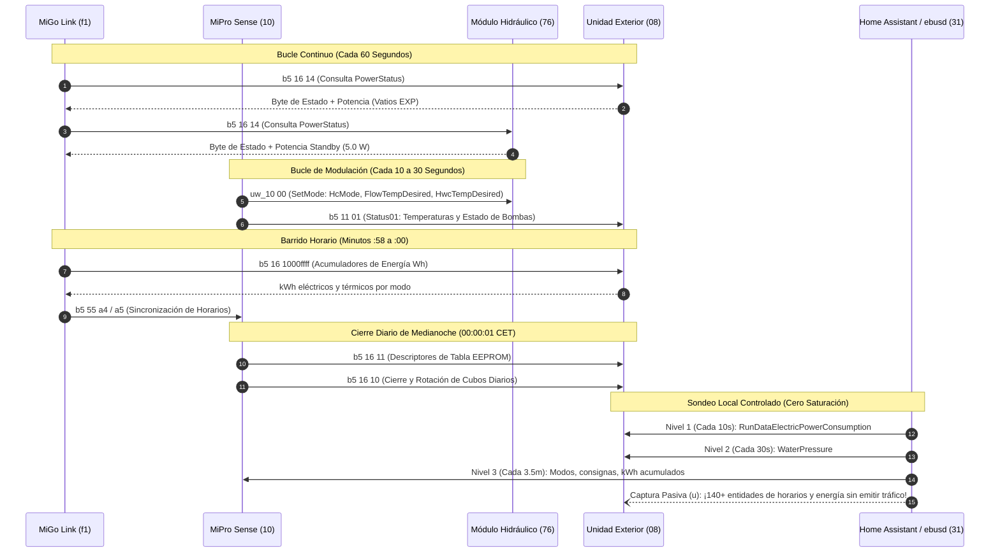
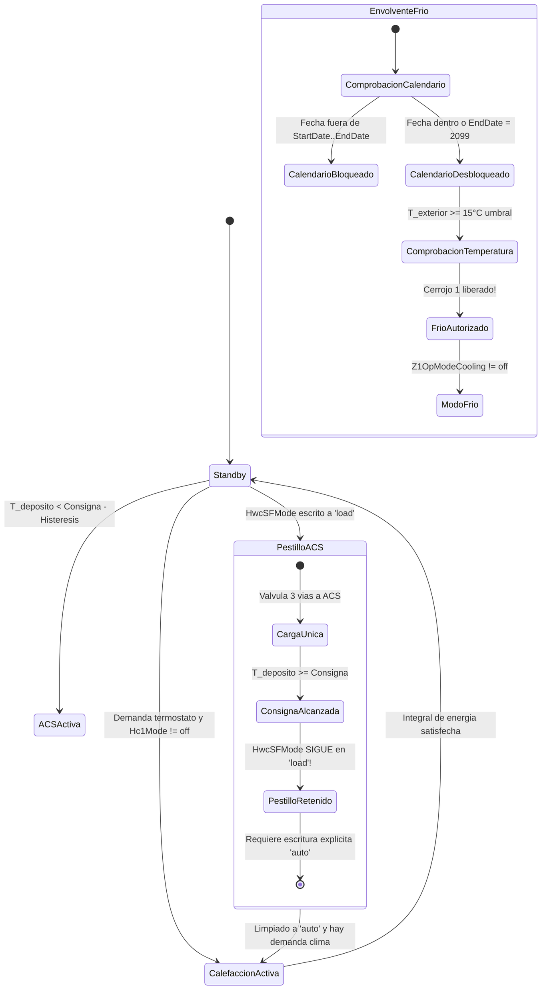

# Referencia Técnica e Ingeniería Inversa del Protocolo eBUS
## Saunier Duval Genia Air Max ES / Vaillant aroTHERM plus

Este documento recoge el desglose técnico exhaustivo de todo el protocolo de comunicación **eBUS** obtenido mediante ingeniería inversa para la última generación de **bombas de calor monobloc de aerotermia con refrigerante R290** del **Grupo Vaillant** (comercializadas indistintamente como **Saunier Duval Genia Air Max ES**, **Vaillant aroTHERM plus** y modelos hermanos de plataforma equipados con la centralita **MiPro Sense / sensoCOMFORT** y la pasarela **MiGo Link / sensoNET**).

---

## 1. Capa Física, Topología del Bus y Asignación de Direcciones

La capa física de eBUS consiste en un bus serie bifilar, no apantallado y con tolerancia a inversión de polaridad que opera a **2.400 baudios** (semidúplex, 8 bits de datos, 1 bit de parada, sin paridad). Emplea acceso múltiple con escucha de portadora y detección de colisiones (**CSMA/CD**) con arbitraje de prioridad a nivel de bit.

### 1.1 Dualidad Maestro / Esclavo
En la especificación de eBUS, cada microcontrolador físico inteligente ocupa obligatoriamente dos direcciones lógicas:
- **Dirección Maestro (Master):** Utilizada para arbitrar el bus, tomar la palabra y transmitir órdenes o consultas.
- **Dirección Esclavo (Slave):** Utilizada para escuchar pasivamente, responder a consultas y recibir parámetros dirigidos a él.

La relación matemática fija e inmutable entre ambas direcciones es:
$$\text{Dirección}_{\text{Slave}} = \text{Dirección}_{\text{Master}} + 0\text{x}05$$

### 1.2 Identificación de Hardware y Mapa de Dispositivos

Una instalación monobloc estándar (ya sea con suelo radiante, radiadores o fancoils) consta de los siguientes participantes en el bus:

| Dirección Master | Dirección Slave | Dispositivo Físico | Identificador de Firmware | Archivo CSV Activo | Función en la Instalación |
| :---: | :---: | :--- | :--- | :--- | :--- |
| **`03`** | **`08`** | Unidad Exterior Monobloc | `MF=Vaillant;ID=HMUX0` | `08.hmux0.csv` | Compresor inverter de velocidad variable, ventilador modulante ECM, válvula de expansión electrónica (EEV), válvula de 4 vías de inversión de ciclo, presostato/sensor de presión de agua, sondas frigoríficas de freón R290, calorímetro de agua. |
| **`10`** | **`15`** | Centralita Climática de Pared | `MF=Vaillant;ID=BASS3` *(MiPro Sense / sensoCOMFORT)* | `15.bass3.csv` | Regulador maestro del sistema, cálculo de curva de calefacción, sonda ambiente de sala, matriz de programación horaria semanal (b5 55), consignas de ACS y clima, modo vacaciones. |
| **`71`** | **`76`** | Módulo Hidráulico Interior / Torre | `MF=Vaillant;ID=VWZIO` *(HPIM 7 / MEH 97/7)* | `76.vwzio.csv` | Válvula de 3 vías de derivación a ACS, bomba circuladora secundaria de impulsión, etapas de apoyo eléctrico (si existen), telemetría de caudal. |
| **`f1`** | **`f6`** | Pasarela de Comunicaciones Wi-Fi | `MF=Vaillant;ID=NETX3` *(MiGo Link / sensoNET)* | `f6.netx3.csv` | Conexión con los servidores en la nube del fabricante, sincronización horaria de red NTP, motor de sondeo de la app móvil oficial. |
| **`ff`** | **`04`** | Interfaz de Aplicación Gateway | `MF=Vaillant;ID=NETX3` | `04.netx3.csv` | Canal broadcast y pasarela de diagnósticos avanzados de la app móvil. |
| **`31`** | **`36`** | Adaptador eBUSd Físico | `ebusd` | *Interno* | Puente local de comunicaciones hacia el broker MQTT y Home Assistant. |

---

## 2. Análisis del Tráfico del Bus, Ciclos de Comunicación y Periodicidad

Comprender qué dispositivo habla con quién, qué telegramas se intercambian y con qué periodicidad exacta es esencial para evitar el colapso del bus a 2.400 baudios (capacidad máxima: ~12 a 15 tramas completas por segundo).

### 2.1 El Motor de la Pasarela (`f1` / `NETX3`)
La pasarela oficial actúa como un maestro de sondeo de alta frecuencia en el bus:
1. **El Bucle de Potencia de 60 Segundos:** Cada 60 segundos ($\pm 1\text{ s}$), `f1` consulta `b5 16 14` a `08` (unidad exterior) y a `76` (torre hidráulica). Este telegrama reporta la potencia eléctrica instantánea en Vatios y el byte de modo operativo.
2. **El Barrido Horario de Energía:** Alrededor del minuto 58 a 00 de cada hora, `f1` realiza un barrido de los contadores de precisión IEEE 754 bajo `b5 16 1000ffff`, recolectando los Wh eléctricos y térmicos para alimentar los cubos horarios de la nube del fabricante.
3. **El Barrido de Programaciones Horarias:** Periódicamente (y siempre que el usuario abre la aplicación móvil oficial), `f1` consulta `b5 55 a4` (conteo de franjas) seguido de `b5 55 a5` en los circuitos `00`, `01`, `02` y `03` para sincronizar los calendarios semanales.
4. **Sincronización Horaria Broadcast:** Transmite telegramas de sincronización horaria UTC/local para mantener en hora todos los relojes de los microcontroladores esclavos.

### 2.2 El Regulador Climático Maestro (`10` / `BASS3`)
La centralita de pared gobierna la termodinámica, las curvas de calefacción y el cierre diario:
1. **El Bucle de Modulación Continuo (10–30 s):** Envía el comando `uw_10 00` (`SetMode`) al módulo hidráulico (`76`) y a la unidad exterior (`08`). Este telegrama fija el modo del sistema (`0=auto`, `1=off`, `2=heat`, `3=water`), la consigna de impulsión calculada (`flowtempdesired`, en formato `D1C`), la consigna de ACS (`hwctempdesired`) y los estados de bomba.
2. **Lectura Hidráulica Continua (10–15 s):** Consulta `b5 11 01` (`Status01`) a `76` y `08`, recopilando temperaturas de impulsión, retorno, interacumulador, exterior y estado de bombas (`0=off`, `1=on`, `2=overrun`, `4=hwc`).
3. **El Cierre de Medianoche en EEPROM (`00:00:01` Diario):** Exactamente a un segundo de la medianoche, `10` emite el comando descriptor `b5 16 11`, rota los cubos diarios de energía en la EEPROM de `08` y `76`, fija el balance del día anterior y avanza la fecha empaquetada de 16 bits.

### 2.3 La Bomba de Calor Exterior Monobloc (`03` / `HMUX0`)
Procesa continuamente sus lazos internos de seguridad y refrigeración:
1. **Telemetría Operativa (`b5 09 540200`):** Actualiza sus registros internos: velocidad del compresor (rps), modulación inverter, pasos de la válvula de expansión (EEV), temperatura de evaporación, temperaturas de entrada/descarga del compresor y calorímetro de agua (`HmuHeatOutput`).
2. **Difusiones Broadcast (`broadcast.tsp`):** Emite telegramas pasivos de estado general y flags de autorización de refrigeración.

### 2.4 Estrategia de Sondeo de eBUSd y Home Assistant
Dado que `f1` y `10` ya generan tráfico considerable, consultar cientos de entidades saturaría la línea. Por ello, diseñamos una **estrategia de cuatro niveles**:
- **Nivel 1 (`@poll(1)`):** Exclusivo para la **Potencia Eléctrica en Tiempo Real** (`RunDataElectricPowerConsumption` en `08.hmux0`). Rota cada ~10 segundos.
- **Nivel 2 (`@poll(3)`):** Exclusivo para la **Presión del Circuito Hidráulico** (`WaterPressure`). Rota cada ~30 segundos.
- **Nivel 3 (`@poll(9)`):** Acumuladores lentos, temperatura exterior y consignas (~3,5 minutos por rotación).
- **Escucha Pasiva Pura (`u`):** Las 140 entidades de horarios semanales (`*_Timer*`), los históricos EEPROM y los registros `PowerStatus` tienen **cero coste de tráfico**. Se capturan pasivamente aprovechando las consultas que `f1` y `10` ya emiten en el bus.

---

## 3. Telemetría de Energía de Alta Precisión (`b5 16`)

### 3.1 Estructura de Trama y Matriz de Decodificación
Todas las consultas de energía utilizan 8 bytes de petición y 11 bytes de respuesta:
- **Petición (`QQ -> 08 / 76 / 15`):** `10 <periodo> ff ff <fuente> <uso> <fecha_empaquetada_2B>`
- **Respuesta (`11 Bytes`):** `<flags_estado_3B> <fuente> <uso> <fecha_empaquetada_2B> <energia_EXP_4B_Wh>`

#### Definición de Campos:
- **`<periodo>`:**
  - `0x00`: **Total Acumulado de Por Vida** (`total_increasing`).
  - `0x01`: Histórico diario.
  - `0x02`: Histórico mensual.
  - `0x03`: Histórico anual.
- **`<fuente>`:** El nibble alto define el sentido del flujo energético (`0x80` = consumida/entrada, `0x40` = entregada/salida):
  - `0x01`: Energía solar térmica (`StatSolarEnergySum`).
  - `0x02` / `0x42`: **Rendimiento ambiental extraído del aire exterior** (Wh).
  - `0x03` / `0x83`: **Energía eléctrica consumida** (Wh).
  - `0x04` / `0x84`: Energía de gas/combustible (devuelve `0.0 Wh` en aerotermia pura).
  - `0x49`: **Energía térmica/frigorífica útil entregada** al agua (Wh).
- **`<uso>` (Circuito / Modo Operativo):**
  - `0x00`: Suma combinada de todos los modos.
  - `0x03`: **Calefacción (`Hc`)**.
  - `0x04`: **Agua Caliente Sanitaria (`Hwc`)**.
  - `0x05`: **Refrigeración (`Cool`)**.
- **`<fecha_empaquetada_2B>`:** Entero little-endian de 16 bits (`yyyyyyy mmmm ddddd`, año base 2000):
  - Ejemplo: `0x350d` (`0d35`) $\rightarrow$ `2026-08-13` (fecha de puesta en marcha física).
  - Ejemplo: `0x3521` (`2135`) $\rightarrow$ `2026-09-01` (cubo mensual de septiembre).
  - Ejemplo: `0x3541` (`4135`) $\rightarrow$ `2026-10-01` (cubo mensual de octubre).
- **`<energia_EXP_4B_Wh>`:** Número en coma flotante simple IEEE 754 de 32 bits little-endian (`EXP`). La unidad física nativa es el **Vatio-hora (`Wh`)**, con una resolución inferior a `0,1 Wh`.

### 3.2 Tabla de Ranuras EEPROM
El comando descriptor nocturno (`b5 16 11`) reporta la distribución de la memoria no volátil:
- **`08.hmux0` (Unidad Exterior):** Responde `02 0309 1009 3409 0a09` $\rightarrow$ **9 ranuras activas (`00` a `08`)**, con buffers circulares para 16 días (`0x10`), 52 meses (`0x34`) y 10 años (`0x0a`).
- **`76.vwzio` (Módulo Hidráulico):** Responde `02 0304 1004 3404 0a04` $\rightarrow$ **4 ranuras activas (`00` a `03`)**.

#### Tabla Completa de Mapeo de Registros:

| Circuito | Subcomando Hex | Ranura | Nombre en CSV | Magnitud Física y Significado Real | Unidad |
| :--- | :--- | :---: | :--- | :--- | :---: |
| **`08.hmux0`** | `1000ffff 83 03 0000` | `00` | `PrEnergyElectricHc` | Consumo eléctrico acumulado: **Calefacción** | `Wh` |
| **`08.hmux0`** | `1000ffff 42 03 0000` | `01` | `PrEnergyEnvYieldHc` | Rendimiento ambiental acumulado: **Calefacción** | `Wh` |
| **`08.hmux0`** | `1000ffff 49 03 0000` | `02` | `PrEnergyThermalHc` | Energía térmica útil entregada: **Calefacción** | `Wh` |
| **`08.hmux0`** | `1000ffff 83 04 0000` | `03` | `PrEnergyElectricHwc`| Consumo eléctrico acumulado: **ACS** | `Wh` |
| **`08.hmux0`** | `1000ffff 42 04 0000` | `04` | `PrEnergyEnvYieldHwc`| Rendimiento ambiental acumulado: **ACS** | `Wh` |
| **`08.hmux0`** | `1000ffff 49 04 0000` | `05` | `PrEnergyThermalHwc`| Energía térmica útil entregada: **ACS** | `Wh` |
| **`08.hmux0`** | `1000ffff 83 05 0000` | `06` | `PrEnergyElectricCool`| Consumo eléctrico acumulado: **Refrigeración** | `Wh` |
| **`08.hmux0`** | `1000ffff 42 05 0000` | `07` | `PrEnergyEnvYieldCool`| Rendimiento ambiental: Frío *(siempre 0 Wh)* | `Wh` |
| **`08.hmux0`** | `1000ffff 49 05 0000` | `08` | `PrEnergyThermalCool`| Energía frigorífica extraída de la vivienda | `Wh` |
| **`76.vwzio`** | `1000ffff 83 03 0000` | `00` | `PrEnergyElectricHc` | Consumo eléctrico: **Standby y Apoyo Interior** | `Wh` |
| **`76.vwzio`** | `1000ffff 49 03 0000` | `01` | `PrEnergyThermalHc` | Energía térmica entregada por resistencia interna (COP 1) | `Wh` |
| **`76.vwzio`** | `1000ffff 83 04 0000` | `02` | `PrEnergyElectricHwc`| Consumo eléctrico de apoyo para ACS | `Wh` |
| **`76.vwzio`** | `1000ffff 49 04 0000` | `03` | `PrEnergyThermalHwc`| Energía térmica de apoyo para ACS | `Wh` |

### 3.3 Potencia Instantánea (`PowerStatus`, `b5 16 14`)
Consultado cada 60 segundos por `f1`:
- **Byte 0 (`status`, `UCH`):**
  - `0`: Standby / Reposo.
  - `1`: Calefacción activa.
  - `2`: Producción de ACS activa.
  - `3`: Refrigeración activa.
- **Bytes 1..4 (`power`, `EXP`, Vatios `W`):** Potencia eléctrica activa en tiempo real.
  - En reposo registra con fidelidad el consumo basal de la electrónica: **`6,0 W`** en `08.hmux0` y **`5,0 W`** en `76.vwzio`.
  - En funcionamiento reproduce la modulación del compresor en tiempo real (de ~400 W a 3.500 W).

---

## 4. Dinámica del Compresor, Modulación y Calorimetría

### 4.1 El Divisor de Utilización del Compresor (`CompressorUtil`)
En el bloque de diagnóstico `b5 09 540200`, la modulación porcentual del compresor se transmite con el tipo de datos `0x38` (56 en decimal). Las pruebas empíricas cruzadas en diferentes modelos de la plataforma demostraron que requiere un **divisor de 16**:

$$\text{Utilización del Compresor (\%)} = \frac{\text{Valor Raw}}{16}$$

La relación matemática entre la velocidad de rotación ($f$ en rps) y el porcentaje de modulación sigue la recta:

$$\text{Utilización (\%)} \approx 0.989 \times \text{rps} - 18.8$$

A la velocidad mínima de rotación ($f_{\text{corte}} \approx 19\text{ rps}$), la utilización reporta **$1,0\%$**. A $60\text{ rps}$, el valor raw `649` arroja:
$$\frac{649}{16} = \mathbf{40,56\%}$$
Coincidiendo con exactitud con los menús de instalador de la máquina.

### 4.2 Calorímetro de Agua Integrado (`HmuHeatOutput`, `0D5E`)
El registro `0D5E` decodifica la potencia térmica útil en Vatios (`W`). La validación frente al cálculo termodinámico mediante caudalímetro calibrado y sondas de ida/retorno ($P = Q \times \Delta T \times 1.163$):
- Potencia física calculada: **3.710 W**
- Valor en el registro `0D5E`: **3.680,65 W**
- Discrepancia: **$0,8\%$**

Esto confirma que `0D5E` actúa como un contador de calor con grado de precisión metrológica en el lado de agua del intercambiador de placas.

### 4.3 Telemetría del Circuito Frigorífico R290 (`08.hmux0`)
Los sub-registros bajo `b5 09 540200` exponen la termodinámica del gas refrigerante:
- **`09C5`:** Modulación PWM y potencia de la bomba circuladora primaria.
- **`0A28`:** Posición absoluta de pasos de la Válvula de Expansión Electrónica EEV (0 a 500 pasos).
- **`0A47`:** Velocidad del ventilador 1 del evaporador (rpm).
- **`0A30`:** Velocidad del ventilador 2 (rpm, en modelos de doble ventilador).
- **`10D1`:** Temperatura de saturación del evaporador ($1/16\ ^\circ\text{C}$).
- **`10D7`:** Recalentamiento útil (*superheat*) en la aspiración ($1/16\text{ K}$): coincide con `RunDataCompressorInletTemp` menos `10D1`.
- **`10DB`:** Temperatura de líquido a la salida del condensador ($1/16\ ^\circ\text{C}$).

---

## 5. Programación Horaria Semanal (`b5 55` / `b5 a5/a6`)

La centralita `15.bass3` gobierna cuatro circuitos de temporización independientes:
- **Circuito `03`:** Calefacción Zona 1 (`Z1Timer`)
- **Circuito `02`:** Agua Caliente Sanitaria (`HwcTimer`)
- **Circuito `01`:** Refrigeración Activa (`CoolingTimer`)
- **Circuito `00`:** Bomba de Recirculación de ACS (`CirculationTimer`)

### 5.1 Conteo de Ranuras (`b5 55 a4`)
Consulta: `f1 15 b555 03 a4 00 <circuito>`  
Respuesta: `09 00 <ranuras_L> <ranuras_M> <ranuras_X> <ranuras_J> <ranuras_V> <ranuras_S> <ranuras_D> 00`  
Cada byte de día indica cuántas franjas horarias ($0$ a $3$) están configuradas.

### 5.2 Lectura (`b5 55 a5`) y Escritura (`b5 55 a6`)
- **Lectura:** Indexada por día (`00` = Lunes .. `06` = Domingo) y ranura (`00` .. `02`).
  - Campos: `from_hour (UCH)`, `from_min (UCH)`, `to_hour (UCH)`, `to_min (UCH)`, `cooling_temp (D1C, solo en circuito 01)`, `ignore (HEX:2 = FFFF)`.
- **Estructura de Escritura:**
  `f1 15 b555 0c a6 ff <circuito> <dia> <ranura> <total_ranuras> <from_hour> <from_min> <to_hour> <to_min> ff ff`
- **Restricción Obligatoria del Relleno `=FFFF`:** Los 2 bytes finales deben inyectarse siempre como `0xFFFF`. Cualquier omisión o relleno nulo provoca que el microcontrolador descarte el paquete sin actualizar la EEPROM.

---

## 6. Enclavamientos, Modos Especiales y Cerrojos de Seguridad

### 6.1 El Mecanismo de Doble Cerrojo de Refrigeración
Para proteger instalaciones de suelo radiante frente a condensaciones y evitar el arranque indebido de frío en invierno, el firmware implementa dos compuertas secuenciales:

#### Compuerta 1: Cerrojo de Calendario Estacional (`CoolingStartDate` y `CoolingEndDate`)
- La compuerta interna de calendario está abierta cuando:
  $$\text{CoolingStartDate} \le \text{FechaActual} \le \text{CoolingEndDate}$$
- Si la fecha actual cae fuera del rango, `CoolingReleaseStatus` reporta `off` (`0`) y el inversor queda bloqueado por hardware contra la inversión de ciclo.
- **Bypass Permanente para Home Assistant:** Fijar `CoolingEndDate` en `01;01;99` (1 de enero de 2099) abre indefinidamente la compuerta 1, delegando el control estacional a Home Assistant.
- **Bloqueo Seguro Invernal:** Escribir `01;01;19` en ambas fechas restaura de inmediato el bloqueo hardware del fabricante.

#### Compuerta 2: Modo Operativo y Consigna Reducida
- `Z1OpModeCooling`: `off`, `auto` (sigue el horario `CoolingTimer`), `day` (manual continuo).
- `Z1CoolingTemp`: Consigna base fuera de franja. Fijada en **30,0 °C**, garantiza que la máquina jamás enfriará por la noche ni durante horas con tarifas eléctricas caras.

### 6.2 El Cerrojo de ACS Puntual (`HwcSFMode = load`)
- **Comportamiento como Pestillo (*Latch*):** Escribir `load` fuerza una carga inmediata del acumulador de ACS. No obstante, **este registro NO se auto-resetea a `auto` al alcanzar la consigna**. Permanece en `load` indefinidamente; si no se envía una orden explícita de `auto`, el sistema retiene la prioridad de ACS de forma permanente.
- **Estrategia de Eficiencia Energética (Arranque Compartido de Compresor):** Activar `HwcSFMode = load` cuando la bomba de calor ya está funcionando en calefacción desvía la válvula de 3 vías hacia el acumulador de agua. Esto transfiere la inercia térmica sin detener el compresor, ahorrando un ciclo completo de arranque mecánico y prolongando la vida útil del equipo.

### 6.3 Anulación Temporal Rápida (`Z1QuickVetoTemp`)
Permite alterar la temperatura de consigna de confort de forma inmediata sin modificar los horarios de la EEPROM. La anulación expira automáticamente en cuanto el reloj interno alcanza el siguiente hito programado en el calendario semanal.

---

## 7. Estandarización de Sondas no Conectadas (`tempv` + `IGN:4`)

En numerosas instalaciones hay entradas de sonda opcionales que no están cableadas (colectores solares, depósito de inercia secundario, etc.):
- Si una entrada vacía se decodifica con tipos numéricos estándar (`D1C` o `D2C`), el microcontrolador emite `0x00 0xFF` o tramas de error que generan lecturas corruptas (`-99 °C` o `3276.7 °C`).
- **Implementación Estándar:** Todas las sondas opcionales en `15.bass3.tsp` están declaradas con el tipo **`tempv`** y un relleno de 4 bytes (`ign: IGN:4`). El decodificador `tempv` verifica el flag de validez del sensor; cuando está desconectado, `ebusd` reporta limpiamente el valor nulo `-`, permitiendo que Home Assistant lo trate como ausente sin registrar errores.

---

## 8. Concurrencia Software y Prevención de Colisiones en el Bus

A 2.400 baudios, los comandos de escritura concurrentes colisionan de inmediato, generando errores de trama en el bus (`ERR: arbitration lost`, `ERR: SYN received`).

La integración de Home Assistant incorpora un **motor de serialización asíncrono**:
1. **Candado Global Asíncrono:** Todas las operaciones de escritura adquieren un cerrojo interno `asyncio.Lock()`.
2. **Verificación Posterior de Lectura (*Read-After-Write*):** Tras emitir cualquier escritura, el coordinador aguarda un intervalo de pausa (`0,8 s`), lanza una lectura de verificación para comprobar que la EEPROM aceptó el nuevo valor, y solo entonces libera el candado.
3. **Filtro Antirrebote (*Debounce*):** Los ajustes rápidos en la interfaz (como deslizar una consigna de temperatura) se filtran para enviar únicamente el valor final estabilizado al bus físico.
